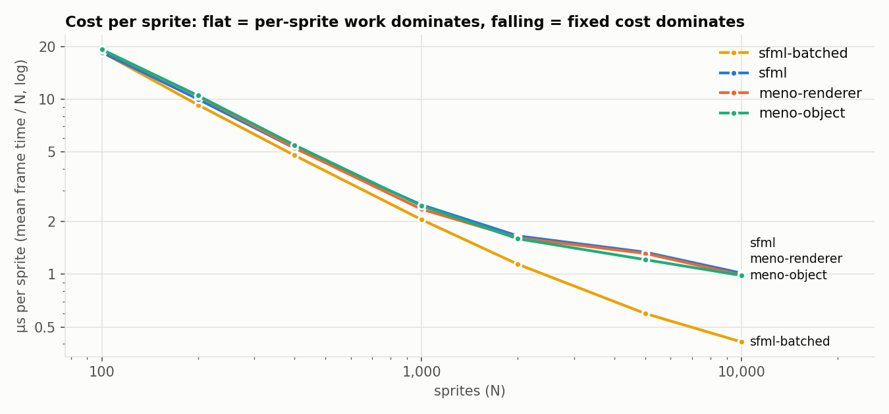
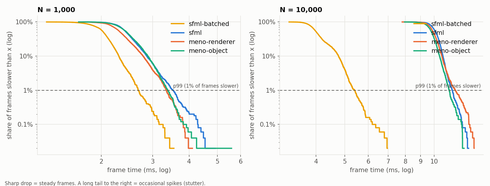

# 성능 측정: 스프라이트 N개 그리기

> **초안 경고: 아래가 해결되기 전에는 결과로 쓰지 않는다.**
>
> - 측정 프로그램(bench_app/)을 커밋하지 않은 채로 쟀다. 어느 코드인지 재현할 수 없다.
> - tracy/notes.md의 관찰·판단이 비어 있다.

배칭을 적용할지 판단하기 위해, 스프라이트 N개를 그리는 프레임 시간을 배칭한 SFML, SFML 직접 사용, meno의 두 경로로 나눠 쟀다(SeoulTech-Fiat-Lux/Meno#30).

## 요약

(작성) 한두 문장으로 결론. 아래 숫자에서 고른다.

- N = 10,000: sfml-batched 4.11 ms, sfml 10.16 ms, meno-renderer 9.89 ms, meno-object 9.85 ms
- sfml/sfml-batched = 2.47, meno-renderer/sfml-batched = 2.41, meno-object/sfml-batched = 2.40

## 측정 방법

| 항목 | 값 |
|---|---|
| 대상 | `sfml-batched`, `sfml`, `meno-renderer`, `meno-object` (기준: `sfml-batched`) |
| N | 100, 200, 400, 1,000, 2,000, 5,000, 10,000 |
| 반복 | (대상, N)마다 새 프로세스로 5회, 순서를 섞음 |
| 프레임 | 워밍업 120프레임을 버리고 1000프레임 기록 |
| 빌드 | Release, 프레임 제한·수직 동기화 끔 |
| 움직임 | 시드로 정한 속도로 이동, 경계에서 튕김, 일정하게 회전. 고정 dt 1/60초. 세 대상이 같은 이동 함수를 씀 |
| 통계 | 측정마다 평균·p50·p99, 반복 사이에서는 중앙값 |

- `sfml-batched`: 사각형 N개를 `sf::VertexArray` 하나에 모아 `draw`를 한 번만 부름 (배칭했을 때의 하한선)
- `sfml`: SFML을 직접 써서 스프라이트마다 `draw`
- `meno-renderer`: meno의 `Renderer`로 직접 그리기
- `meno-object`: `GameObject` + `Sprite` 컴포넌트 (사용자가 실제로 쓰는 경로)

## 측정 환경

| 항목 | 값 |
|---|---|
| 날짜 | 2026-11-14T22:57:47+09:00 |
| CPU | AMD Ryzen 7 9700X 8-Core Processor (16스레드) |
| GPU (GL 렌더러) | D3D12 (AMD Radeon(TM) Graphics) |
| OpenGL | 4.6 (Compatibility Profile) Mesa 25.2.8-0ubuntu0.24.04.4 |
| OS | Linux-6.18.58.1-microsoft-standard-WSL2-x86_64-with-glibc2.39 |
| 컴파일러 | gcc (Ubuntu 13.3.0-6ubuntu2~24.04.1) 13.3.0 |
| meno | `46f8934` () |
| 측정 프로그램 | meno_exp `68087a1`의 `benchmark/bench_app/` (meno를 고치지 않고 공개 API로만 잼) |
| 수직 동기화 확인 | 통과: 끔 1.27 ms(p10 1.15, p90 1.45)로 어느 주사율 주기에도 묶여 있지 않다. 대조군: 이 환경은 vsync 요청을 지원하지 않아 켜도 1.41 ms다(WSLg의 d3d12 등). 프레임이 늘 동기화 없이 돈다 |

WSL2(WSLg)에서 쟀다. Windows 화면 합성을 거치므로 리눅스 기본 설치보다 느릴 수 있다. 대상 사이의 비교에는 쓸 수 있지만, 절대 수치는 이 환경 기준이다.

## 결과

### 프레임 시간


| 대상 | 통계 | 60 fps (16.7ms) | 30 fps (33.3ms) |
|---|---|---:|---:|
| sfml-batched | mean | 10,000까지 넘지 않음 | 10,000까지 넘지 않음 |
| sfml | mean | 10,000까지 넘지 않음 | 10,000까지 넘지 않음 |
| meno-renderer | mean | 10,000까지 넘지 않음 | 10,000까지 넘지 않음 |
| meno-object | mean | 10,000까지 넘지 않음 | 10,000까지 넘지 않음 |
| sfml-batched | p99 | 10,000까지 넘지 않음 | 10,000까지 넘지 않음 |
| sfml | p99 | 10,000까지 넘지 않음 | 10,000까지 넘지 않음 |
| meno-renderer | p99 | 10,000까지 넘지 않음 | 10,000까지 넘지 않음 |
| meno-object | p99 | 10,000까지 넘지 않음 | 10,000까지 넘지 않음 |

#### 프레임 시간 평균

| N | sfml-batched (ms) | sfml (ms) | meno-renderer (ms) | meno-object (ms) | sfml/sfml-batched | meno-renderer/sfml | meno-object/meno-renderer | meno-object/sfml-batched |
|---:|---:|---:|---:|---:|---:|---:|---:|---:|
| 100 | 1.859 | 1.856 | 1.921 | 1.927 | 1.00 | 1.03 | 1.00 | 1.04 |
| 200 | 1.859 | 2.003 | 2.091 | 2.101 | 1.08 | 1.04 | 1.00 | 1.13 |
| 400 | 1.915 | 2.108 | 2.114 | 2.194 | 1.10 | 1.00 | 1.04 | 1.15 |
| 1000 | 2.052 | 2.493 | 2.354 | 2.461 | 1.22 | 0.94 | 1.05 | 1.20 |
| 2000 | 2.282 | 3.314 | 3.234 | 3.193 | 1.45 | 0.98 | 0.99 | 1.40 |
| 5000 | 2.987 | 6.691 | 6.581 | 6.064 | 2.24 | 0.98 | 0.92 | 2.03 |
| 10000 | 4.107 | 10.161 | 9.893 | 9.846 | 2.47 | 0.97 | 1.00 | 2.40 |

#### 프레임 시간 p99

| N | sfml-batched (ms) | sfml (ms) | meno-renderer (ms) | meno-object (ms) | sfml/sfml-batched | meno-renderer/sfml | meno-object/meno-renderer | meno-object/sfml-batched |
|---:|---:|---:|---:|---:|---:|---:|---:|---:|
| 100 | 2.542 | 2.610 | 2.512 | 2.574 | 1.03 | 0.96 | 1.02 | 1.01 |
| 200 | 2.506 | 2.772 | 2.814 | 2.968 | 1.11 | 1.01 | 1.05 | 1.18 |
| 400 | 2.533 | 2.904 | 2.963 | 2.940 | 1.15 | 1.02 | 0.99 | 1.16 |
| 1000 | 2.688 | 3.346 | 3.256 | 3.279 | 1.24 | 0.97 | 1.01 | 1.22 |
| 2000 | 3.099 | 4.486 | 4.223 | 4.144 | 1.45 | 0.94 | 0.98 | 1.34 |
| 5000 | 4.134 | 7.930 | 8.108 | 7.785 | 1.92 | 1.02 | 0.96 | 1.88 |
| 10000 | 5.250 | 11.326 | 11.130 | 11.150 | 2.16 | 0.98 | 1.00 | 2.12 |

값은 반복 사이의 중앙값이다. 반복별 범위는 summary.csv의 *_min, *_max.

### 단계별 비용


| N | sfml-batched base | sfml-batched → sfml | sfml → meno-renderer | meno-renderer → meno-object |
|---:|---:|---:|---:|---:|
| 100 | 96 | 0 | 3 | 0 |
| 200 | 88 | 7 | 4 | 0 |
| 400 | 87 | 9 | 0 | 4 |
| 1,000 | 79 | 17 | 0 | 4 |
| 2,000 | 69 | 31 | 0 | 0 |
| 5,000 | 45 | 55 | 0 | 0 |
| 10,000 | 40 | 60 | 0 | 0 |

음수 단계가 있어 0으로 잘랐다: N = [100, 1000, 2000, 5000, 10000]. 앞 대상보다 빨랐다는 뜻이므로 summary.md에서 확인한다.

(작성) 어느 단계에서 비용이 붙는가. `sfml-batched → sfml` 칸이 스프라이트마다 `draw`를 부르는 비용, 곧 배칭으로 줄일 수 있는 몫이다.

### 스프라이트 하나당 비용



| 대상 | N=100 | N=200 | N=400 | N=1,000 | N=2,000 | N=5,000 | N=10,000 |
|---|---:|---:|---:|---:|---:|---:|---:|
| sfml-batched | 18.59 | 9.29 | 4.79 | 2.05 | 1.14 | 0.60 | 0.41 |
| sfml | 18.56 | 10.02 | 5.27 | 2.49 | 1.66 | 1.34 | 1.02 |
| meno-renderer | 19.20 | 10.45 | 5.29 | 2.35 | 1.62 | 1.32 | 0.99 |
| meno-object | 19.27 | 10.50 | 5.49 | 2.46 | 1.60 | 1.21 | 0.98 |

(작성) N이 커질 때 평평해지는가(개수에 비례하는 비용이 주도), 내려가는가(고정 비용이 주도).

### 프레임 시간 분포



| N | 대상 | p50 | p99 | 최대 | p99/p50 |
|---:|---|---:|---:|---:|---:|
| 1,000 | sfml-batched | 2.035 | 2.679 | 3.547 | 1.32 |
| 1,000 | sfml | 2.434 | 3.523 | 4.915 | 1.45 |
| 1,000 | meno-renderer | 2.324 | 3.341 | 4.106 | 1.44 |
| 1,000 | meno-object | 2.447 | 3.380 | 5.591 | 1.38 |
| 10,000 | sfml-batched | 4.016 | 5.394 | 6.949 | 1.34 |
| 10,000 | sfml | 10.120 | 11.510 | 13.054 | 1.14 |
| 10,000 | meno-renderer | 9.927 | 11.786 | 13.619 | 1.19 |
| 10,000 | meno-object | 9.796 | 11.235 | 12.601 | 1.15 |

(작성) p99가 높은 이유가 가끔 튀는 프레임인가, 전반적인 느림인가.

## 병목 (Tracy)


워밍업 120프레임을 뺀 기록 프레임(N=1,000: 600개, N=10,000: 600개)의 프레임당 self time(ms). 구간끼리 겹치지 않으므로 더하면 프레임 시간이 된다. `not instrumented`는 `frame` 구간의 self time, 곧 어느 하위 구간에도 속하지 않은 시간이다.

| 구간 | N=1,000 (ms) | N=10,000 (ms) | N=1,000 (%) | N=10,000 (%) |
|---|---:|---:|---:|---:|
| window.display | 2.809 | 6.286 | 87 | 59 |
| scene.draw | 0.258 | 4.040 | 8 | 38 |
| renderer.begin | 0.117 | 0.126 | 4 | 1 |
| bench.move | 0.008 | 0.066 | 0 | 1 |
| bench.apply | 0.005 | 0.058 | 0 | 1 |
| app.events | 0.014 | 0.020 | 0 | 0 |
| other zones | 0.001 | 0.002 | 0 | 0 |
| not instrumented | 0.001 | 0.001 | 0 | 0 |
| **프레임 평균** | **3.212** | **10.598** | 100 | 100 |

### N=1,000 → N=10,000에서 늘어난 비용

N에 비례해 늘어나는 구간이 배칭·최적화 대상이다. 거의 그대로인 구간은 고정 비용이다.

| 구간 | 늘어난 ms | 배수 |
|---|---:|---:|
| scene.draw | 3.782 | 15.7× |
| window.display | 3.478 | 2.2× |
| bench.move | 0.058 | 8.1× |
| bench.apply | 0.053 | 11.7× |
| renderer.begin | 0.009 | 1.1× |
| app.events | 0.006 | 1.4× |
| other zones | 0.001 | 1.6× |
| not instrumented | 0.000 | 1.1× |

(작성) tracy/notes.md의 관찰·판단을 채운 뒤 report.py를 다시 돌린다.

## 배칭 판단

- **결론:** (작성) 적용한다 / 적용하지 않는다 / 조건부
- **근거:** (작성) 위 숫자 두세 개
- **예상 효과:** (작성) 줄어들 구간과 그 크기
- **다음 할 일:** (작성)

## 한계

- 수치는 위 측정 환경 기준이다. WSLg를 거친 값이다. 다른 GPU·드라이버에서는 절대값이 달라진다.
- Tracy 결과는 계측을 켠 빌드에서 얻었다. 비율을 보는 데 쓰고, 프레임 시간 표에는 쓰지 않았다.
- (작성) 그 밖의 한계

## 재현

meno_exp의 `benchmark/README.md`를 따른다.

```bash
python3 vsync_check.py --out results/<결과 폴더>
python3 run.py
python3 summarize.py results/<결과 폴더> && python3 figures.py results/<결과 폴더>
python3 tracy.py capture
```
