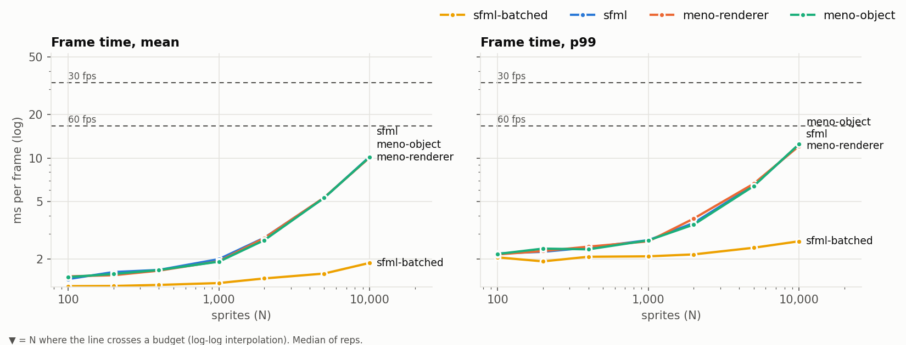
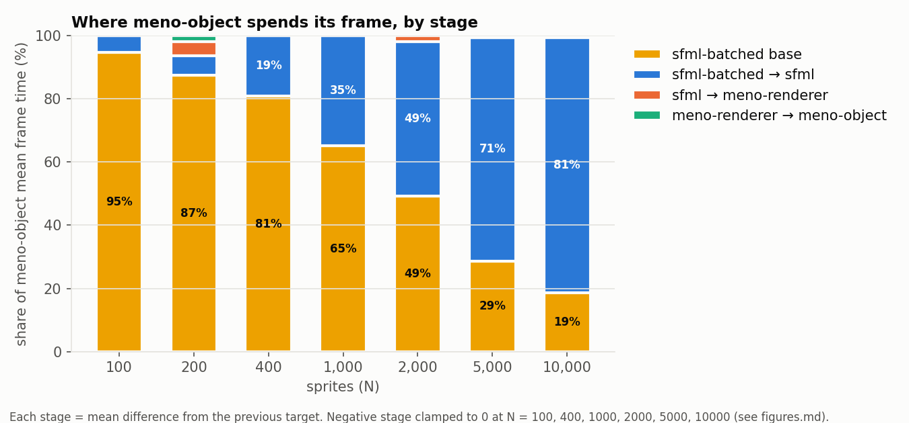
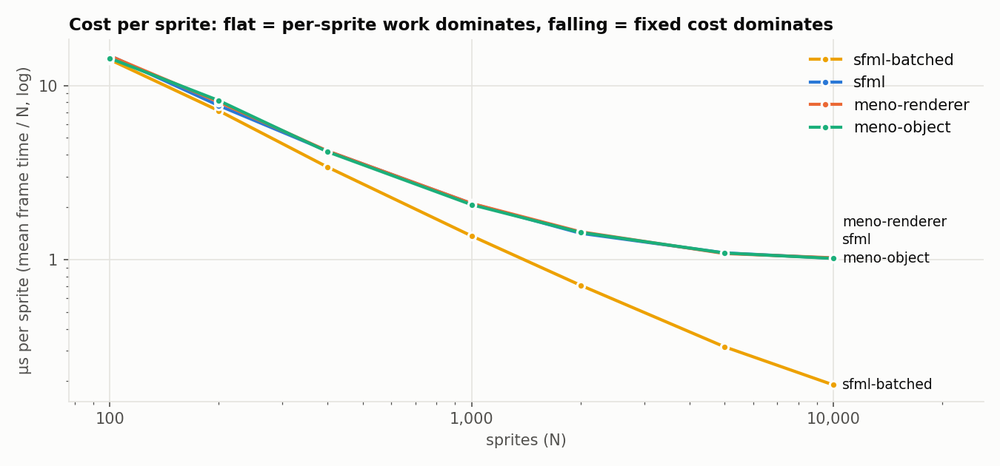
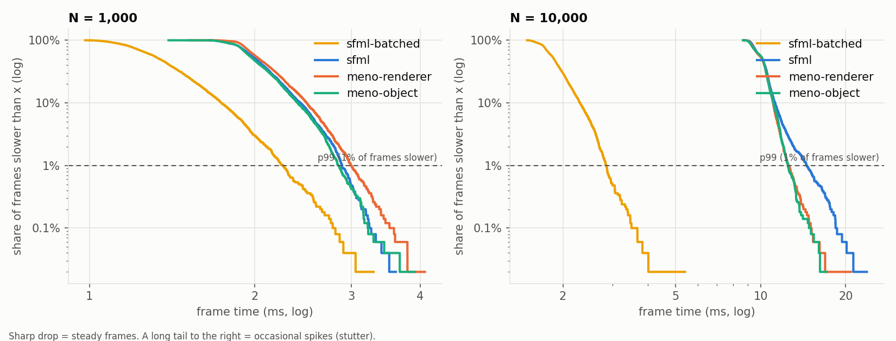
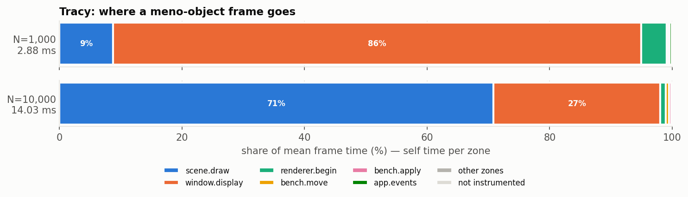

# 성능 측정: 스프라이트 N개 그리기

> **경고: 아래를 해결하기 전에는 이 결과를 쓰지 않는다.**
>
> - NVIDIA GeForce RTX 5070 Ti: tracy/notes.md에 채우지 않은 "(작성)" 자리가 있다. 채우거나 그 줄을 지운다.
> - AMD Radeon(TM) Graphics: tracy/notes.md에 채우지 않은 "(작성)" 자리가 있다. 채우거나 그 줄을 지운다.

배칭을 적용할지 판단할 근거로, 스프라이트 N개를 그리는 프레임 시간을 네 경로로 쟀다(SeoulTech-Fiat-Lux/Meno#30). 이 문서는 `report.py`가 결과 폴더에서 만든다. 고치지 말고 다시 만든다.

## 요약

N = 10,000에서 프레임 시간 평균(ms):

| 대상 | NVIDIA GeForce RTX 5070 Ti | AMD Radeon(TM) Graphics |
|---|---:|---:|
| `sfml-batched` | 1.88 | 3.95 |
| `sfml` | 10.21 | 9.42 |
| `meno-renderer` | 10.08 | 9.42 |
| `meno-object` | 10.17 | 9.40 |

- **배칭 효과** (`sfml` / `sfml-batched`, N = 10,000): NVIDIA GeForce RTX 5070 Ti 5.43배, AMD Radeon(TM) Graphics 2.39배
- **meno가 더하는 비용**: `meno-renderer` / `sfml` 0.95~1.04, `meno-object` / `meno-renderer` 0.97~1.02 (모든 GPU·N의 범위. 1.00이면 더하는 비용이 없다)
- **60 fps 예산** (p99 ≤ 16.7 ms): NVIDIA GeForce RTX 5070 Ti는 모든 대상이 측정한 가장 큰 N(10,000)까지 안; AMD Radeon(TM) Graphics는 모든 대상이 측정한 가장 큰 N(10,000)까지 안
- **GPU 사이 차이** (같은 CPU, N = 10,000): `sfml` 8%, `sfml-batched` 110%. → 배칭하지 않은 비용은 GPU를 바꿔도 거의 같으므로 CPU(그리기 호출 제출)가 정한다. 배칭하면 GPU가 정한다. (판정 기준: `sfml` 차이 15% 이하)
- **Tracy** (NVIDIA GeForce RTX 5070 Ti, `meno-object` N = 10,000): `scene.draw` 71%, `window.display` 27%
- **Tracy** (AMD Radeon(TM) Graphics, `meno-object` N = 10,000): `window.display` 60%, `scene.draw` 37%

## 측정 방법

| 대상 | 프레임마다 하는 일 |
|---|---|
| `sfml-batched` | 사각형 N개를 `sf::VertexArray` 하나에 모아 `draw` 1번 (배칭했을 때의 하한) |
| `sfml` | SFML을 직접 써서 `sf::Sprite`마다 `draw` (N번) |
| `meno-renderer` | meno `Game` 루프에서 `Renderer::draw` N번 |
| `meno-object` | `GameObject` + `Sprite` 컴포넌트 N개 (사용자가 실제로 쓰는 경로) |

- N: 100, 200, 400, 1,000, 2,000, 5,000, 10,000. (대상, N)마다 새 프로세스로 5회, 순서를 섞음. 워밍업 120프레임을 버리고 1000프레임 기록.
- Release 빌드, 프레임 제한·수직 동기화 끔. 네 대상이 같은 텍스처·시드·이동 함수를 쓴다(고정 dt 1/60초).
- 측정마다 평균·p50·p99를 내고, 반복 사이에서는 중앙값을 쓴다.

## 측정 환경

| 항목 | NVIDIA GeForce RTX 5070 Ti | AMD Radeon(TM) Graphics |
|---|---|---|
| 날짜 | 2026-11-14T23:21:38+09:00 | 2026-11-14T23:31:21+09:00 |
| GPU (GL 렌더러) | D3D12 (NVIDIA GeForce RTX 5070 Ti) | D3D12 (AMD Radeon(TM) Graphics) |
| CPU | AMD Ryzen 7 9700X 8-Core Processor (16스레드) | AMD Ryzen 7 9700X 8-Core Processor (16스레드) |
| CPU 상태 | 기록 없음 | 기록 없음 |
| OpenGL | 4.6 (Compatibility Profile) Mesa 25.2.8-0ubuntu0.24.04.4 | 4.6 (Compatibility Profile) Mesa 25.2.8-0ubuntu0.24.04.4 |
| OS | Linux-6.18.58.1-microsoft-standard-WSL2-x86_64-with-glibc2.39 | Linux-6.18.58.1-microsoft-standard-WSL2-x86_64-with-glibc2.39 |
| meno | `46f8934` | `46f8934` |
| 측정 프로그램 | meno_exp `96aed21`의 bench_app | meno_exp `96aed21`의 bench_app |
| 수직 동기화 확인 | 통과: 끔 1.53 ms(p10 1.42, p90 1.80)로 어느 주사율 주기에도 묶여 있지 않다. 대조군: 이 환경은 vsync 요청을 지원하지 않아 켜도 1.44 ms다(WSLg의 d3d12 등). 프레임이 늘 동기화 없이 돈다 | 통과: 끔 1.39 ms(p10 1.25, p90 1.52)로 어느 주사율 주기에도 묶여 있지 않다. 대조군: 이 환경은 vsync 요청을 지원하지 않아 켜도 1.30 ms다(WSLg의 d3d12 등). 프레임이 늘 동기화 없이 돈다 |
| 결과 폴더 | [20261114-46f8934-rtx-5070-ti](20261114-46f8934-rtx-5070-ti) | [20261114-46f8934-radeon](20261114-46f8934-radeon) |

## 결과: NVIDIA GeForce RTX 5070 Ti

### 프레임 시간 평균

| N | sfml-batched (ms) | sfml (ms) | meno-renderer (ms) | meno-object (ms) | sfml/sfml-batched | meno-renderer/sfml | meno-object/meno-renderer | meno-object/sfml-batched |
|---:|---:|---:|---:|---:|---:|---:|---:|---:|
| 100 | 1.296 | 1.452 | 1.516 | 1.498 | 1.12 | 1.04 | 0.99 | 1.16 |
| 200 | 1.301 | 1.624 | 1.543 | 1.574 | 1.25 | 0.95 | 1.02 | 1.21 |
| 400 | 1.322 | 1.679 | 1.660 | 1.677 | 1.27 | 0.99 | 1.01 | 1.27 |
| 1000 | 1.362 | 1.996 | 1.929 | 1.916 | 1.47 | 0.97 | 0.99 | 1.41 |
| 2000 | 1.466 | 2.804 | 2.791 | 2.699 | 1.91 | 1.00 | 0.97 | 1.84 |
| 5000 | 1.585 | 5.310 | 5.333 | 5.307 | 3.35 | 1.00 | 1.00 | 3.35 |
| 10000 | 1.879 | 10.208 | 10.084 | 10.166 | 5.43 | 0.99 | 1.01 | 5.41 |

### 프레임 시간 p99

| N | sfml-batched (ms) | sfml (ms) | meno-renderer (ms) | meno-object (ms) | sfml/sfml-batched | meno-renderer/sfml | meno-object/meno-renderer | meno-object/sfml-batched |
|---:|---:|---:|---:|---:|---:|---:|---:|---:|
| 100 | 2.051 | 2.182 | 2.152 | 2.167 | 1.06 | 0.99 | 1.01 | 1.06 |
| 200 | 1.925 | 2.242 | 2.269 | 2.360 | 1.16 | 1.01 | 1.04 | 1.23 |
| 400 | 2.072 | 2.398 | 2.435 | 2.332 | 1.16 | 1.02 | 0.96 | 1.13 |
| 1000 | 2.086 | 2.699 | 2.650 | 2.693 | 1.29 | 0.98 | 1.02 | 1.29 |
| 2000 | 2.151 | 3.552 | 3.811 | 3.462 | 1.65 | 1.07 | 0.91 | 1.61 |
| 5000 | 2.392 | 6.479 | 6.644 | 6.403 | 2.71 | 1.03 | 0.96 | 2.68 |
| 10000 | 2.654 | 12.364 | 12.137 | 12.508 | 4.66 | 0.98 | 1.03 | 4.71 |

값은 반복 사이의 중앙값이다. 반복별 범위는 summary.csv의 *_min, *_max.

그림의 값: [figures.md](20261114-46f8934-rtx-5070-ti/figures/figures.md)

## 결과: AMD Radeon(TM) Graphics

### 프레임 시간 평균

| N | sfml-batched (ms) | sfml (ms) | meno-renderer (ms) | meno-object (ms) | sfml/sfml-batched | meno-renderer/sfml | meno-object/meno-renderer | meno-object/sfml-batched |
|---:|---:|---:|---:|---:|---:|---:|---:|---:|
| 100 | 1.829 | 1.823 | 1.813 | 1.846 | 1.00 | 0.99 | 1.02 | 1.01 |
| 200 | 1.824 | 1.966 | 1.976 | 1.938 | 1.08 | 1.00 | 0.98 | 1.06 |
| 400 | 1.832 | 2.110 | 2.103 | 2.099 | 1.15 | 1.00 | 1.00 | 1.15 |
| 1000 | 1.945 | 2.449 | 2.432 | 2.411 | 1.26 | 0.99 | 0.99 | 1.24 |
| 2000 | 2.111 | 3.105 | 3.078 | 3.066 | 1.47 | 0.99 | 1.00 | 1.45 |
| 5000 | 2.737 | 6.416 | 6.090 | 5.924 | 2.34 | 0.95 | 0.97 | 2.16 |
| 10000 | 3.949 | 9.419 | 9.423 | 9.401 | 2.39 | 1.00 | 1.00 | 2.38 |

### 프레임 시간 p99

| N | sfml-batched (ms) | sfml (ms) | meno-renderer (ms) | meno-object (ms) | sfml/sfml-batched | meno-renderer/sfml | meno-object/meno-renderer | meno-object/sfml-batched |
|---:|---:|---:|---:|---:|---:|---:|---:|---:|
| 100 | 2.329 | 2.447 | 2.423 | 2.414 | 1.05 | 0.99 | 1.00 | 1.04 |
| 200 | 2.374 | 2.591 | 2.612 | 2.618 | 1.09 | 1.01 | 1.00 | 1.10 |
| 400 | 2.385 | 2.769 | 2.715 | 2.697 | 1.16 | 0.98 | 0.99 | 1.13 |
| 1000 | 2.440 | 3.253 | 3.243 | 3.222 | 1.33 | 1.00 | 0.99 | 1.32 |
| 2000 | 2.775 | 3.935 | 3.920 | 3.926 | 1.42 | 1.00 | 1.00 | 1.42 |
| 5000 | 3.684 | 7.590 | 7.369 | 7.405 | 2.06 | 0.97 | 1.00 | 2.01 |
| 10000 | 4.997 | 10.595 | 10.588 | 10.498 | 2.12 | 1.00 | 0.99 | 2.10 |

값은 반복 사이의 중앙값이다. 반복별 범위는 summary.csv의 *_min, *_max.

그림의 값: [figures.md](20261114-46f8934-radeon/figures/figures.md)

## 병목 (Tracy)

Tracy를 켠 빌드로 `meno-object`를 캡처했다. 프레임이 느려지므로 구간 비율만 보고, 프레임 시간은 위 표를 쓴다. OpenGL 드라이버는 그리기 명령을 모아 두었다가 나중에 처리할 수 있어서, 그리기 비용 일부가 `window.display`에 잡히기도 한다. `scene.draw`와 `window.display`는 합쳐서 읽는다.

### NVIDIA GeForce RTX 5070 Ti

워밍업 120프레임을 뺀 기록 프레임(N=1,000: 600개, N=10,000: 600개)의 프레임당 self time(ms). 구간끼리 겹치지 않으므로 더하면 프레임 시간이 된다. `not instrumented`는 `frame` 구간의 self time, 곧 어느 하위 구간에도 속하지 않은 시간이다.

| 구간 | N=1,000 (ms) | N=10,000 (ms) | N=1,000 (%) | N=10,000 (%) |
|---|---:|---:|---:|---:|
| scene.draw | 0.252 | 9.941 | 9 | 71 |
| window.display | 2.480 | 3.817 | 86 | 27 |
| renderer.begin | 0.121 | 0.125 | 4 | 1 |
| bench.move | 0.008 | 0.076 | 0 | 1 |
| bench.apply | 0.005 | 0.054 | 0 | 0 |
| app.events | 0.012 | 0.017 | 0 | 0 |
| other zones | 0.001 | 0.001 | 0 | 0 |
| not instrumented | 0.000 | 0.001 | 0 | 0 |
| **프레임 평균** | **2.878** | **14.032** | 100 | 100 |

#### N=1,000 → N=10,000에서 늘어난 비용

N에 비례해 늘어나는 구간이 배칭·최적화 대상이다. 거의 그대로인 구간은 고정 비용이다.

| 구간 | 늘어난 ms | 배수 |
|---|---:|---:|
| scene.draw | 9.689 | 39.4× |
| window.display | 1.337 | 1.5× |
| bench.move | 0.068 | 9.9× |
| bench.apply | 0.049 | 11.2× |
| app.events | 0.006 | 1.5× |
| renderer.begin | 0.004 | 1.0× |
| other zones | 0.000 | 1.5× |
| not instrumented | 0.000 | 1.9× |

**관찰** (tracy/notes.md, 사람이 씀)

- 가장 비싼 구간과 그 비율 (N이 가장 클 때): N=10,000에서 `scene.draw`가 9.94 ms로 프레임의 71%. 그다음 `window.display` 3.82 ms(27%).
- N에 비례해 늘어나는 구간: `scene.draw`가 N=1,000→10,000에서 0.25→9.94 ms(+9.69 ms, 39배). 스프라이트 하나에 약 1.1 µs. `window.display`도 2.48→3.82 ms(+1.34 ms)로 조금 는다.
- 거의 그대로인 구간(고정 비용): `window.display`의 대부분(N=1,000에서 2.48 ms), `renderer.begin` 0.12 ms, `app.events` 0.01 ms.
- 스프라이트마다 하는 CPU 계산: `bench.move` + `bench.apply`가 N=10,000에서 0.13 ms(1%). 움직임 계산과 Transform 쓰기는 병목이 아니다.
- `not instrumented`: 0.001 ms. 프레임 시간은 모두 구간 안에 들어가 있다.
- 평균과 중앙값이 거의 같다(N=10,000 프레임 평균 14.03, 중앙값 13.93 ms). 튀는 프레임이 평균을 끌어올린 것이 아니다.
- Tracy를 켜면 프레임이 느려진다: N=10,000에서 14.03 ms. Tracy 없이 잰 meno-object는 10.17 ms(`../summary.md`). 그래서 이 표의 ms는 비율로만 읽고, 프레임 시간 수치는 `../summary.md`를 쓴다.
- Tracy 화면 캡처: 없음. 비율 그림은 `zones.png`.

**판단** (tracy/notes.md, 사람이 씀)

- 병목: 스프라이트마다 한 번씩 하는 그리기 호출(`scene.draw`). N=1,000→10,000에서 프레임이 11.15 ms 늘었고, 그중 9.69 ms(87%)가 여기서 생긴다.
- 배칭으로 줄어들 부분: `scene.draw` 안의 그리기 호출 비용. Tracy 없이 잰 표에서 sfml-batched는 N=10,000에 1.88 ms, sfml은 10.21 ms(5.43배).
- 배칭으로 안 줄어드는 부분: `window.display`의 고정 비용(약 1.3~2.5 ms), 움직임 계산과 Transform 쓰기(0.13 ms). 장면 순회 비용은 Tracy로는 따로 나누지 않았지만, meno-object/meno-renderer가 모든 N에서 0.97~1.02라 무시할 만하다.
- 결론과 다음 할 일: (작성) 예: 이 PC에서는 N=10,000에서도 p99 12.5 ms로 60 fps 예산(16.7 ms) 안이라 배칭이 당장 필요하지는 않다. 다만 N에 비례하는 비용의 대부분이 그리기 호출이므로, 스프라이트 수가 더 많거나 CPU가 느린 환경을 목표로 하면 배칭이 가장 효과가 크다.

### AMD Radeon(TM) Graphics

워밍업 120프레임을 뺀 기록 프레임(N=1,000: 600개, N=10,000: 600개)의 프레임당 self time(ms). 구간끼리 겹치지 않으므로 더하면 프레임 시간이 된다. `not instrumented`는 `frame` 구간의 self time, 곧 어느 하위 구간에도 속하지 않은 시간이다.

| 구간 | N=1,000 (ms) | N=10,000 (ms) | N=1,000 (%) | N=10,000 (%) |
|---|---:|---:|---:|---:|
| window.display | 2.748 | 5.872 | 86 | 60 |
| scene.draw | 0.253 | 3.648 | 8 | 37 |
| renderer.begin | 0.153 | 0.109 | 5 | 1 |
| bench.move | 0.007 | 0.063 | 0 | 1 |
| bench.apply | 0.004 | 0.046 | 0 | 0 |
| app.events | 0.012 | 0.013 | 0 | 0 |
| other zones | 0.001 | 0.001 | 0 | 0 |
| not instrumented | 0.001 | 0.001 | 0 | 0 |
| **프레임 평균** | **3.179** | **9.753** | 100 | 100 |

#### N=1,000 → N=10,000에서 늘어난 비용

N에 비례해 늘어나는 구간이 배칭·최적화 대상이다. 거의 그대로인 구간은 고정 비용이다.

| 구간 | 늘어난 ms | 배수 |
|---|---:|---:|
| scene.draw | 3.394 | 14.4× |
| window.display | 3.124 | 2.1× |
| bench.move | 0.055 | 8.7× |
| bench.apply | 0.042 | 11.4× |
| app.events | 0.002 | 1.1× |
| other zones | 0.000 | 1.5× |
| not instrumented | 0.000 | 1.0× |
| renderer.begin | -0.044 | 0.7× |

**관찰** (tracy/notes.md, 사람이 씀)

- 가장 비싼 구간과 그 비율 (N이 가장 클 때): N=10,000에서 `window.display`가 5.87 ms로 60%, `scene.draw`는 3.65 ms로 37%. RTX와 순서가 반대다.
- N에 비례해 늘어나는 구간: `scene.draw` 0.25→3.65 ms(+3.39 ms)와 `window.display` 2.75→5.87 ms(+3.12 ms). 두 구간이 거의 같은 만큼 는다.
- 두 구간을 합쳐 읽는다: OpenGL 드라이버는 그리기 명령을 모아 두었다가 나중에 처리할 수 있다. 이 드라이버는 그리기 비용의 절반 가까이를 화면을 넘기는 `window.display` 때 치르는 것으로 보인다. 그래서 `scene.draw` + `window.display`를 그리기 비용으로 본다. 이 합은 3.00→9.50 ms(중앙값)로 는다.
- 거의 그대로인 구간(고정 비용): `window.display`의 N=1,000 몫(2.75 ms), `renderer.begin` 0.11~0.15 ms, `app.events` 0.01 ms.
- 스프라이트마다 하는 CPU 계산: `bench.move` + `bench.apply`가 N=10,000에서 0.11 ms(1%).
- `not instrumented`: 0.001 ms.
- 평균과 중앙값이 거의 같다(N=10,000 프레임 평균 9.75, 중앙값 9.72 ms).
- Tracy를 켠 프레임 시간: N=10,000에서 9.75 ms. Tracy 없이 잰 값은 9.40 ms(`../summary.md`). RTX보다 덜 느려진다.
- Tracy 화면 캡처: 없음. 비율 그림은 `zones.png`.

**판단** (tracy/notes.md, 사람이 씀)

- 병목: 스프라이트마다 한 번씩 하는 그리기 호출. 이 GPU에서는 그 비용이 `scene.draw`와 `window.display`에 나뉘어 잡힌다.
- 배칭으로 줄어들 부분: 두 구간에서 N에 비례해 는 몫(+6.5 ms). Tracy 없이 잰 표에서 sfml-batched는 N=10,000에 3.95 ms, sfml은 9.42 ms(2.39배).
- 배칭으로 안 줄어드는 부분: `window.display`의 고정 몫, 움직임 계산과 Transform 쓰기(0.11 ms). 배칭한 경우에도 N=100→10,000에서 1.83→3.95 ms로 늘어난다. 이 GPU에서는 스프라이트 수에 따른 GPU 쪽 비용이 남는다.
- 결론과 다음 할 일: (작성) 예: 내장 GPU에서도 N=10,000 p99가 10.5 ms라 60 fps 예산 안이다. 배칭 효과는 RTX보다 작다(2.39배 대 5.43배). 배칭 뒤에는 GPU 성능이 상한을 정한다.

## 한계

- 수치는 위 측정 환경 기준이다. 다른 GPU·드라이버·CPU에서는 절대값이 달라진다.
- WSL2(WSLg)에서 쟀다. Windows 화면 합성을 거치고, OpenGL 호출을 Direct3D 12로 바꾸는 비용이 CPU에 더해진다.
- CPU는 AMD Ryzen 7 9700X 8-Core Processor만 썼다. 느린 CPU에서의 수치는 없다.
- Tracy 결과는 계측을 켠 빌드에서 얻었다. 비율을 보는 데 쓰고 프레임 시간 표에는 쓰지 않았다.

## 재현

meno_exp의 `benchmark/README.md`를 위에서부터 따라 한다.
