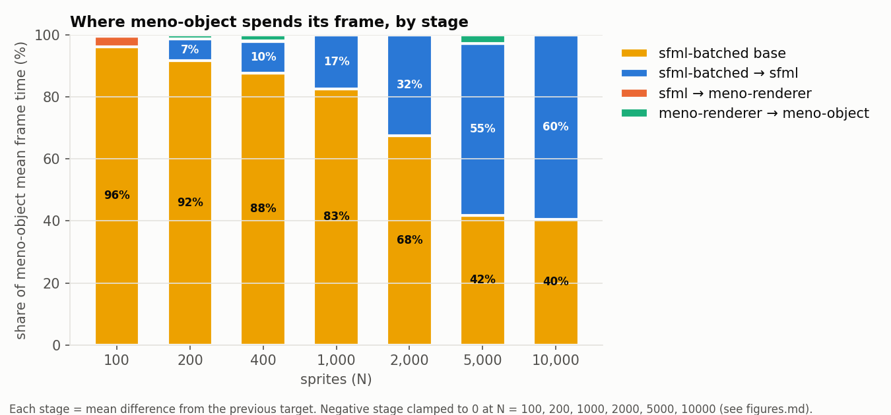
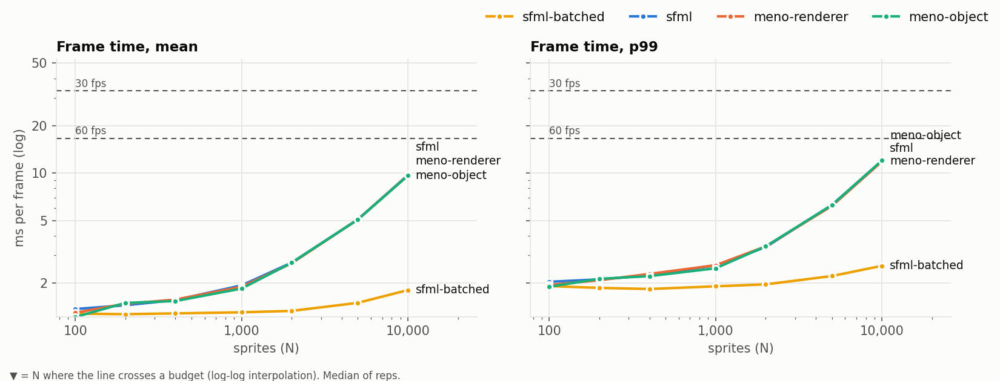
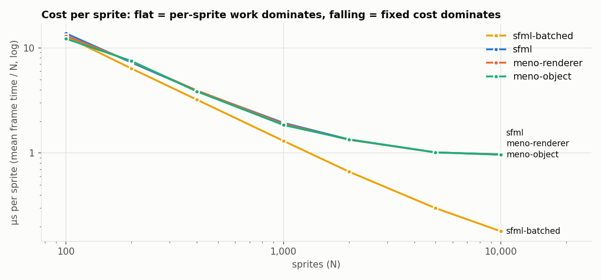
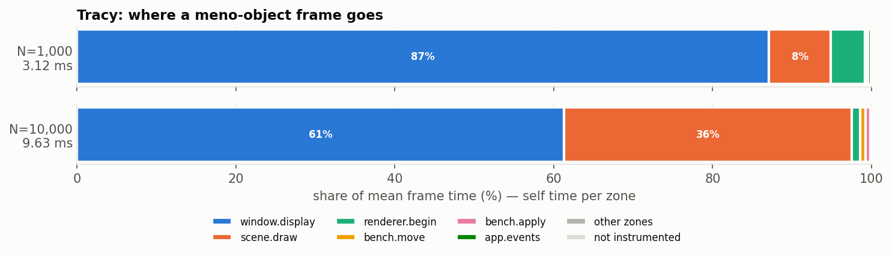
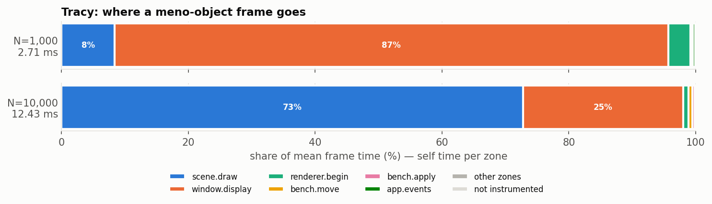

# 성능 측정: 스프라이트 N개 그리기

배칭을 적용할지 판단할 근거로, 스프라이트 N개를 그리는 프레임 시간을 네 경로로 쟀다(SeoulTech-Fiat-Lux/Meno#30). 이 문서는 `report.py`가 결과 폴더에서 만든다. 고치지 말고 다시 만든다.

## 요약

N = 10,000에서 프레임 시간 평균(ms):

| 대상 | AMD Radeon(TM) Graphics | NVIDIA GeForce RTX 5070 Ti |
|---|---:|---:|
| `sfml-batched` | 3.84 | 1.81 |
| `sfml` | 9.49 | 9.72 |
| `meno-renderer` | 9.40 | 9.66 |
| `meno-object` | 9.33 | 9.64 |

- **배칭 효과** (`sfml` / `sfml-batched`, N = 10,000): AMD Radeon(TM) Graphics 2.47배, NVIDIA GeForce RTX 5070 Ti 5.38배
- **meno가 더하는 비용**: `meno-renderer` / `sfml` 0.95~1.04, `meno-object` / `meno-renderer` 0.94~1.03 (모든 GPU·N의 범위. 1.00이면 더하는 비용이 없다)
- **60 fps 예산** (p99 ≤ 16.7 ms): AMD Radeon(TM) Graphics는 모든 대상이 측정한 가장 큰 N(10,000)까지 안; NVIDIA GeForce RTX 5070 Ti는 모든 대상이 측정한 가장 큰 N(10,000)까지 안
- **GPU 사이 차이** (같은 CPU, N = 10,000): `sfml` 2%, `sfml-batched` 113%. → 배칭하지 않은 비용은 GPU를 바꿔도 거의 같으므로 CPU(그리기 호출 제출)가 정한다. 배칭하면 GPU가 정한다. (판정 기준: `sfml` 차이 15% 이하)
- **Tracy** (AMD Radeon(TM) Graphics, `meno-object` N = 10,000): `window.display` 61%, `scene.draw` 36%
- **Tracy** (NVIDIA GeForce RTX 5070 Ti, `meno-object` N = 10,000): `scene.draw` 73%, `window.display` 25%

## 측정 방법

| 대상 | 프레임마다 하는 일 |
|---|---|
| `sfml-batched` | 사각형 N개를 `sf::VertexArray` 하나에 모아 `draw` 1번 (배칭했을 때의 하한) |
| `sfml` | SFML을 직접 써서 `sf::Sprite`마다 `draw` (N번) |
| `meno-renderer` | meno `Game` 루프에서 `Renderer::draw` N번 |
| `meno-object` | `GameObject` + `Sprite` 컴포넌트 N개 (사용자가 실제로 쓰는 경로) |

- N: 100, 200, 400, 1,000, 2,000, 5,000, 10,000. (대상, N)마다 새 프로세스로 5회, 순서를 섞음. 워밍업 120프레임을 버리고 1000프레임 기록.
- Release 빌드, 프레임 제한·수직 동기화 끔. 네 대상이 같은 텍스처·시드·이동 함수를 쓴다(고정 dt 1/60초).
- 측정마다 평균·p50·p99를 내고, 반복 사이에서는 중앙값을 쓴다.

## 측정 환경

| 항목 | AMD Radeon(TM) Graphics | NVIDIA GeForce RTX 5070 Ti |
|---|---|---|
| 날짜 | 2026-11-16T12:08:56+09:00 | 2026-11-16T11:32:49+09:00 |
| GPU (GL 렌더러) | D3D12 (AMD Radeon(TM) Graphics) | D3D12 (NVIDIA GeForce RTX 5070 Ti) |
| CPU | AMD Ryzen 7 9700X 8-Core Processor (16스레드) | AMD Ryzen 7 9700X 8-Core Processor (16스레드) |
| CPU 상태 | 전원 모드 최고 성능, 최대 프로세서 상태 100%, 측정 직전 Windows CPU 중앙값 10%, 측정 중 다른 WSL 작업 최대 0.50코어 | 전원 모드 최고 성능, 최대 프로세서 상태 100%, 측정 직전 Windows CPU 중앙값 6%, 측정 중 다른 WSL 작업 최대 0.56코어 |
| OpenGL | 4.6 (Compatibility Profile) Mesa 25.2.8-0ubuntu0.24.04.4 | 4.6 (Compatibility Profile) Mesa 25.2.8-0ubuntu0.24.04.4 |
| OS | Linux-6.18.58.1-microsoft-standard-WSL2-x86_64-with-glibc2.39 | Linux-6.18.58.1-microsoft-standard-WSL2-x86_64-with-glibc2.39 |
| meno | `46f8934` | `46f8934` |
| 측정 프로그램 | meno_exp `d2e6dc6`의 bench_app | meno_exp `c62e3b3`의 bench_app |
| 수직 동기화 확인 | 통과: 끔 1.25 ms(p10 1.12, p90 1.38)로 어느 주사율 주기에도 묶여 있지 않다. 대조군: 이 환경은 vsync 요청을 지원하지 않아 켜도 1.32 ms다(WSLg의 d3d12 등). 프레임이 늘 동기화 없이 돈다 | 통과: 끔 1.33 ms(p10 1.25, p90 1.50)로 어느 주사율 주기에도 묶여 있지 않다. 대조군: 이 환경은 vsync 요청을 지원하지 않아 켜도 1.30 ms다(WSLg의 d3d12 등). 프레임이 늘 동기화 없이 돈다 |
| 결과 폴더 | [20261116-46f8934-radeon](20261116-46f8934-radeon) | [20261116-46f8934-rtx-5070-ti](20261116-46f8934-rtx-5070-ti) |

## 결과: AMD Radeon(TM) Graphics

### 프레임 시간 평균

| N | sfml-batched (ms) | sfml (ms) | meno-renderer (ms) | meno-object (ms) | sfml/sfml-batched | meno-renderer/sfml | meno-object/meno-renderer | meno-object/sfml-batched |
|---:|---:|---:|---:|---:|---:|---:|---:|---:|
| 100 | 1.760 | 1.708 | 1.771 | 1.779 | 0.97 | 1.04 | 1.00 | 1.01 |
| 200 | 1.765 | 1.900 | 1.865 | 1.891 | 1.08 | 0.98 | 1.01 | 1.07 |
| 400 | 1.772 | 1.980 | 1.984 | 2.022 | 1.12 | 1.00 | 1.02 | 1.14 |
| 1000 | 1.980 | 2.396 | 2.351 | 2.341 | 1.21 | 0.98 | 1.00 | 1.18 |
| 2000 | 2.070 | 3.066 | 3.042 | 3.028 | 1.48 | 0.99 | 1.00 | 1.46 |
| 5000 | 2.696 | 6.271 | 5.963 | 6.137 | 2.33 | 0.95 | 1.03 | 2.28 |
| 10000 | 3.839 | 9.488 | 9.395 | 9.332 | 2.47 | 0.99 | 0.99 | 2.43 |

### 프레임 시간 p99

| N | sfml-batched (ms) | sfml (ms) | meno-renderer (ms) | meno-object (ms) | sfml/sfml-batched | meno-renderer/sfml | meno-object/meno-renderer | meno-object/sfml-batched |
|---:|---:|---:|---:|---:|---:|---:|---:|---:|
| 100 | 2.334 | 2.221 | 2.293 | 2.297 | 0.95 | 1.03 | 1.00 | 0.98 |
| 200 | 2.318 | 2.490 | 2.548 | 2.478 | 1.07 | 1.02 | 0.97 | 1.07 |
| 400 | 2.322 | 2.542 | 2.670 | 2.605 | 1.09 | 1.05 | 0.98 | 1.12 |
| 1000 | 2.479 | 2.994 | 3.033 | 3.050 | 1.21 | 1.01 | 1.01 | 1.23 |
| 2000 | 2.674 | 3.778 | 3.849 | 3.813 | 1.41 | 1.02 | 0.99 | 1.43 |
| 5000 | 3.659 | 7.240 | 7.258 | 7.311 | 1.98 | 1.00 | 1.01 | 2.00 |
| 10000 | 4.799 | 10.455 | 10.388 | 10.325 | 2.18 | 0.99 | 0.99 | 2.15 |

값은 반복 사이의 중앙값이다. 반복별 범위는 summary.csv의 *_min, *_max.

그림의 값: [figures.md](20261116-46f8934-radeon/figures/figures.md)

## 결과: NVIDIA GeForce RTX 5070 Ti

### 프레임 시간 평균

| N | sfml-batched (ms) | sfml (ms) | meno-renderer (ms) | meno-object (ms) | sfml/sfml-batched | meno-renderer/sfml | meno-object/meno-renderer | meno-object/sfml-batched |
|---:|---:|---:|---:|---:|---:|---:|---:|---:|
| 100 | 1.280 | 1.369 | 1.296 | 1.218 | 1.07 | 0.95 | 0.94 | 0.95 |
| 200 | 1.270 | 1.446 | 1.479 | 1.497 | 1.14 | 1.02 | 1.01 | 1.18 |
| 400 | 1.284 | 1.561 | 1.571 | 1.538 | 1.22 | 1.01 | 0.98 | 1.20 |
| 1000 | 1.305 | 1.935 | 1.895 | 1.846 | 1.48 | 0.98 | 0.97 | 1.42 |
| 2000 | 1.332 | 2.698 | 2.674 | 2.694 | 2.03 | 0.99 | 1.01 | 2.02 |
| 5000 | 1.499 | 5.068 | 5.078 | 5.075 | 3.38 | 1.00 | 1.00 | 3.39 |
| 10000 | 1.806 | 9.721 | 9.665 | 9.638 | 5.38 | 0.99 | 1.00 | 5.34 |

### 프레임 시간 p99

| N | sfml-batched (ms) | sfml (ms) | meno-renderer (ms) | meno-object (ms) | sfml/sfml-batched | meno-renderer/sfml | meno-object/meno-renderer | meno-object/sfml-batched |
|---:|---:|---:|---:|---:|---:|---:|---:|---:|
| 100 | 1.915 | 2.040 | 1.947 | 1.897 | 1.06 | 0.95 | 0.97 | 0.99 |
| 200 | 1.865 | 2.112 | 2.087 | 2.130 | 1.13 | 0.99 | 1.02 | 1.14 |
| 400 | 1.835 | 2.239 | 2.289 | 2.215 | 1.22 | 1.02 | 0.97 | 1.21 |
| 1000 | 1.909 | 2.596 | 2.599 | 2.485 | 1.36 | 1.00 | 0.96 | 1.30 |
| 2000 | 1.963 | 3.386 | 3.423 | 3.426 | 1.72 | 1.01 | 1.00 | 1.75 |
| 5000 | 2.219 | 6.278 | 6.187 | 6.259 | 2.83 | 0.99 | 1.01 | 2.82 |
| 10000 | 2.576 | 11.976 | 11.874 | 12.035 | 4.65 | 0.99 | 1.01 | 4.67 |

값은 반복 사이의 중앙값이다. 반복별 범위는 summary.csv의 *_min, *_max.

그림의 값: [figures.md](20261116-46f8934-rtx-5070-ti/figures/figures.md)

## 병목 (Tracy)

Tracy를 켠 빌드로 `meno-object`를 캡처했다. 프레임이 느려지므로 구간 비율만 보고, 프레임 시간은 위 표를 쓴다. OpenGL 드라이버는 그리기 명령을 모아 두었다가 나중에 처리할 수 있어서, 그리기 비용 일부가 `window.display`에 잡히기도 한다. `scene.draw`와 `window.display`는 합쳐서 읽는다.

### AMD Radeon(TM) Graphics

워밍업 120프레임을 뺀 기록 프레임(N=1,000: 600개, N=10,000: 600개)의 프레임당 self time(ms). 구간끼리 겹치지 않으므로 더하면 프레임 시간이 된다. `not instrumented`는 `frame` 구간의 self time, 곧 어느 하위 구간에도 속하지 않은 시간이다.

| 구간 | N=1,000 (ms) | N=10,000 (ms) | N=1,000 (%) | N=10,000 (%) |
|---|---:|---:|---:|---:|
| window.display | 2.712 | 5.903 | 87 | 61 |
| scene.draw | 0.244 | 3.489 | 8 | 36 |
| renderer.begin | 0.132 | 0.105 | 4 | 1 |
| bench.move | 0.007 | 0.063 | 0 | 1 |
| bench.apply | 0.005 | 0.057 | 0 | 1 |
| app.events | 0.013 | 0.013 | 0 | 0 |
| other zones | 0.001 | 0.002 | 0 | 0 |
| not instrumented | 0.000 | 0.001 | 0 | 0 |
| **프레임 평균** | **3.115** | **9.632** | 100 | 100 |

#### N=1,000 → N=10,000에서 늘어난 비용

N에 비례해 늘어나는 구간이 배칭·최적화 대상이다. 거의 그대로인 구간은 고정 비용이다.

| 구간 | 늘어난 ms | 배수 |
|---|---:|---:|
| scene.draw | 3.244 | 14.3× |
| window.display | 3.191 | 2.2× |
| bench.move | 0.057 | 9.5× |
| bench.apply | 0.051 | 10.5× |
| other zones | 0.001 | 1.6× |
| not instrumented | 0.000 | 1.1× |
| app.events | 0.000 | 1.0× |
| renderer.begin | -0.028 | 0.8× |

**관찰** (tracy/notes.md, 사람이 씀)

- 가장 비싼 구간: N=10,000에서 가장 큰 비중을 차지하는 구간은 `window.display`(61%)이며, `scene.draw`(36%)가 그 뒤를 잇는다. 두 구간을 합하면 프레임 시간의 97%에 이른다.
- N에 비례해 느는 구간: N을 1,000에서 10,000으로 늘렸을 때 증가한 시간은 `scene.draw`(50%)와 `window.display`(49%)에 거의 절반씩 나뉘며, 두 구간의 합이 증가분의 99%를 차지한다. 스프라이트 하나당 증가분은 약 0.7 µs로, Tracy 없이 측정한 `sfml`의 증가분(약 0.79 µs)과 비슷하다.
- 고정 비용 구간: `renderer.begin`과 `app.events`는 N과 관계없이 거의 일정하다. 화면을 넘기는 고정 비용은 약 1.8 ms로, RTX 5070 Ti(약 1.3 ms)보다 크다(../summary.md의 N≤400 `sfml-batched` 기준).
- 이 GPU에서 다른 점: 그리기 비용의 절반이 `window.display`에서 발생한다. 드라이버가 그리기 명령을 모아 두었다가 화면을 넘길 때 한꺼번에 처리하는 것으로 보인다. 따라서 `window.display`만 보면 화면 전환이 병목인 것처럼 보이지만, 실제로는 그리기 호출의 비용이다. 한편 Tracy를 켰을 때 프레임이 느려지는 정도는 3%로, RTX 5070 Ti(29%)보다 훨씬 작다.

**판단** (tracy/notes.md, 사람이 씀)

- 병목: 병목은 스프라이트마다 한 번씩 호출하는 그리기 함수이며, 이 GPU에서는 그 비용이 `scene.draw`와 `window.display`에 나뉘어 측정된다. 반면 이동 계산과 Transform 갱신(`bench.move`와 `bench.apply`)은 프레임 시간의 1%에 그친다.
- 배칭으로 줄어드는 몫: 배칭으로 줄일 수 있는 것은 두 구간에서 N에 비례하여 늘어나는 비용이다. 이는 N=10,000에서 `meno-object` 프레임 시간의 60%에 해당하며, SFML에 배칭을 적용하면 프레임 시간이 9.49 ms에서 3.84 ms로 줄어든다(2.47배).
- 배칭으로 안 줄어드는 몫: 화면을 넘기는 고정 비용(약 1.8 ms)과 GPU가 스프라이트를 그리는 비용은 배칭으로 줄지 않는다. 배칭을 적용해도 N이 100에서 10,000으로 늘면 프레임 시간이 1.76 ms에서 3.84 ms로 증가한다(RTX 5070 Ti는 1.28 ms에서 1.81 ms). 즉, 이 GPU에서는 배칭 이후 GPU 성능이 프레임 시간의 상한을 결정한다.

### NVIDIA GeForce RTX 5070 Ti

워밍업 120프레임을 뺀 기록 프레임(N=1,000: 600개, N=10,000: 600개)의 프레임당 self time(ms). 구간끼리 겹치지 않으므로 더하면 프레임 시간이 된다. `not instrumented`는 `frame` 구간의 self time, 곧 어느 하위 구간에도 속하지 않은 시간이다.

| 구간 | N=1,000 (ms) | N=10,000 (ms) | N=1,000 (%) | N=10,000 (%) |
|---|---:|---:|---:|---:|
| scene.draw | 0.228 | 9.048 | 8 | 73 |
| window.display | 2.368 | 3.136 | 87 | 25 |
| renderer.begin | 0.095 | 0.108 | 4 | 1 |
| bench.move | 0.007 | 0.071 | 0 | 1 |
| bench.apply | 0.003 | 0.049 | 0 | 0 |
| app.events | 0.011 | 0.015 | 0 | 0 |
| other zones | 0.000 | 0.001 | 0 | 0 |
| not instrumented | 0.000 | 0.001 | 0 | 0 |
| **프레임 평균** | **2.713** | **12.429** | 100 | 100 |

#### N=1,000 → N=10,000에서 늘어난 비용

N에 비례해 늘어나는 구간이 배칭·최적화 대상이다. 거의 그대로인 구간은 고정 비용이다.

| 구간 | 늘어난 ms | 배수 |
|---|---:|---:|
| scene.draw | 8.821 | 39.8× |
| window.display | 0.768 | 1.3× |
| bench.move | 0.064 | 10.3× |
| bench.apply | 0.046 | 15.4× |
| renderer.begin | 0.013 | 1.1× |
| app.events | 0.003 | 1.3× |
| other zones | 0.001 | 2.4× |
| not instrumented | 0.000 | 1.2× |

**관찰** (tracy/notes.md, 사람이 씀)

- 가장 비싼 구간: N=10,000에서 가장 큰 비중을 차지하는 구간은 `scene.draw`(73%)이며, `window.display`(25%)가 그 뒤를 잇는다. 두 구간을 합하면 프레임 시간의 98%에 이른다.
- N에 비례해 느는 구간: N을 1,000에서 10,000으로 늘렸을 때 증가한 시간의 91%가 `scene.draw`에서 발생하며, 이 구간은 39.8배로 늘어난다. 스프라이트 하나당 증가분은 약 0.98 µs로, Tracy 없이 측정한 `sfml`의 스프라이트당 비용(약 0.97 µs)과 일치한다.
- 고정 비용 구간: `window.display`는 같은 범위에서 1.3배 늘어나는 데 그친다. 즉, 화면을 넘기는 비용은 N과 거의 관계가 없으며, 그 크기는 약 1.3 ms이다(../summary.md의 N≤400 `sfml-batched` 기준).
- 이 GPU에서 다른 점: 그리기 비용이 `scene.draw`에 곧바로 측정되며, `window.display`의 증가분은 0.77 ms에 불과하다. 따라서 이 GPU에서는 `scene.draw`만 보아도 그리기 호출의 비용을 파악할 수 있다. 한편 Tracy를 켰을 때 프레임이 느려지는 정도는 29%로, 내장 Radeon(3%)보다 훨씬 크다.

**판단** (tracy/notes.md, 사람이 씀)

- 병목: 병목은 스프라이트마다 한 번씩 호출하는 그리기 함수이며, 이 GPU에서는 그 비용이 대부분 `scene.draw`에서 측정된다. 반면 이동 계산과 Transform 갱신(`bench.move`와 `bench.apply`)은 프레임 시간의 1%에 그친다.
- 배칭으로 줄어드는 몫: 배칭으로 줄일 수 있는 것은 `scene.draw`의 그리기 호출 비용이다. 이는 N=10,000에서 `meno-object` 프레임 시간의 81%에 해당하며, SFML에 배칭을 적용하면 프레임 시간이 9.72 ms에서 1.81 ms로 줄어든다(5.38배).
- 배칭으로 안 줄어드는 몫: 화면을 넘기는 고정 비용(약 1.3 ms)과 스프라이트마다 수행하는 CPU 계산(프레임 시간의 1%)은 배칭으로 줄지 않는다. 배칭을 적용한 뒤에도 N이 100에서 10,000으로 늘면 프레임 시간이 1.28 ms에서 1.81 ms로 소폭 증가한다. 한편 meno의 장면 순회와 Renderer는 비용을 더하지 않는다(단계별 비용 비율 0.94~1.02).

## 한계

- 수치는 위 측정 환경 기준이다. 다른 GPU·드라이버·CPU에서는 절대값이 달라진다.
- WSL2(WSLg)에서 쟀다. Windows 화면 합성을 거치고, OpenGL 호출을 Direct3D 12로 바꾸는 비용이 CPU에 더해진다.
- CPU는 AMD Ryzen 7 9700X 8-Core Processor만 썼다. 느린 CPU에서의 수치는 없다.
- Tracy 결과는 계측을 켠 빌드에서 얻었다. 비율을 보는 데 쓰고 프레임 시간 표에는 쓰지 않았다.

## 재현

meno_exp의 `benchmark/README.md`를 위에서부터 따라 한다.
