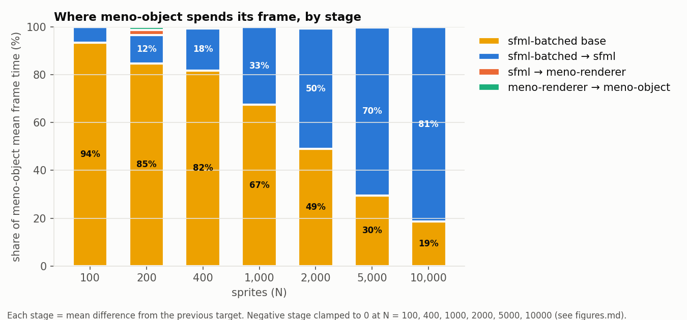
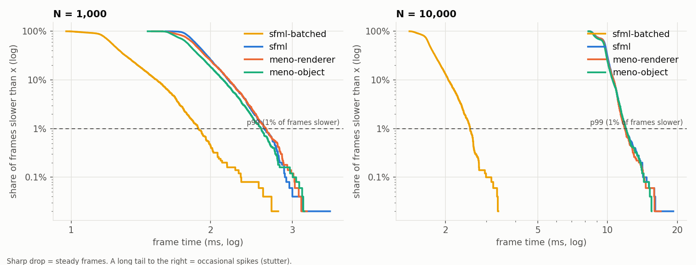
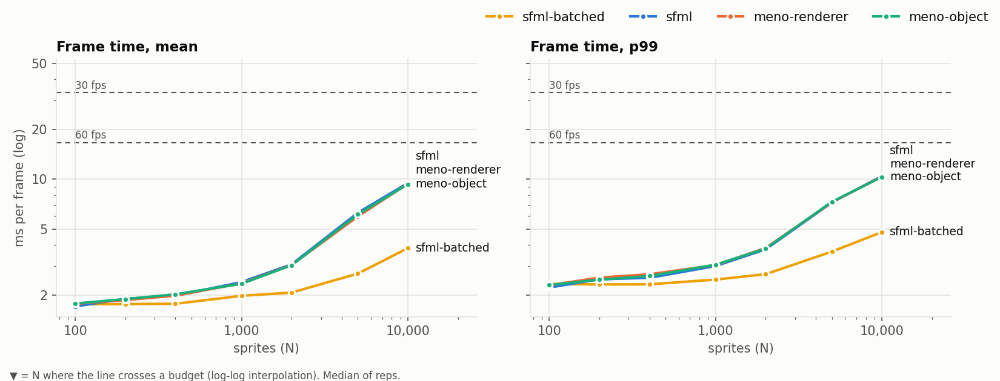
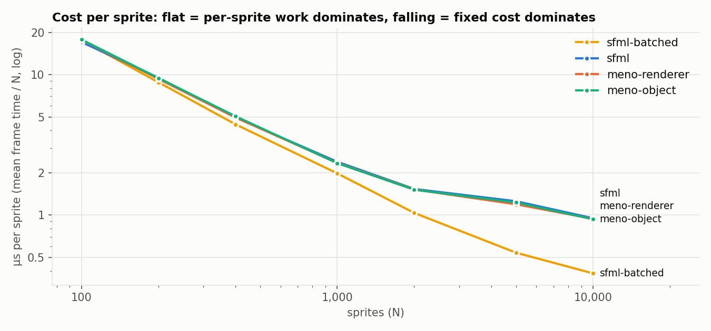
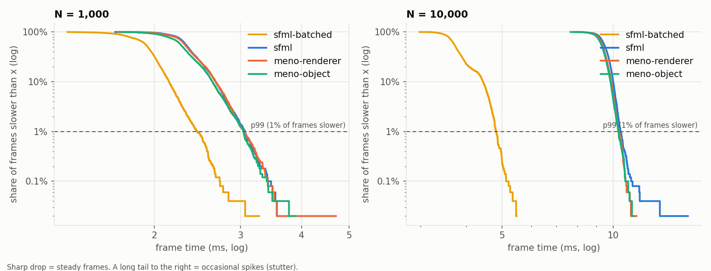

# 성능 측정: 스프라이트 N개 그리기

Meno 라이브러리에 배칭을 적용할 때 이점이 있을지를 판단하기 위해, 스프라이트 N개를 그리는 데 걸리는 프레임 시간을 네 가지 경로로 측정했다(SeoulTech-Fiat-Lux/Meno#30).

## 요약

N = 10,000에서의 평균 프레임 시간(ms)은 다음과 같다.

| 대상 | NVIDIA GeForce RTX 5070 Ti | AMD Radeon(TM) Graphics |
|---|---:|---:|
| `sfml-batched` | 1.81 | 3.84 |
| `sfml` | 9.72 | 9.49 |
| `meno-renderer` | 9.66 | 9.40 |
| `meno-object` | 9.64 | 9.33 |

- **배칭 효과**: N = 10,000에서 `sfml`의 프레임 시간은 `sfml-batched`의 5.38배(NVIDIA GeForce RTX 5070 Ti), 2.47배(AMD Radeon(TM) Graphics)이다.
- **meno가 더하는 비용**: 모든 GPU와 N에서 `meno-renderer`/`sfml`은 0.95-1.04, `meno-object`/`meno-renderer`는 0.94-1.03이다. N ≥ 1,000의 16개 비교에서 95% 신뢰구간의 상한은 모두 1.04 이하다. 따라서 meno는 측정 가능한 비용을 더하지 않으며(5% 미만), 그리기 성능을 높이지도 않는다.
- **60 fps 예산**(p99 16.7 ms 이하): 이 PC(AMD Ryzen 7 9700X)에서는 모든 GPU와 대상이 측정한 가장 큰 N(10,000)까지 예산 안에 든다.
- **GPU 사이 차이**(같은 CPU, N = 10,000): GPU에 따라 `sfml`은 2%, `sfml-batched`는 113% 차이가 난다. 따라서 배칭하지 않을 때의 비용은 CPU(그리기 호출 제출)가 결정하고, 배칭하면 GPU가 결정한다.
- **Tracy**(`meno-object`, N = 10,000): 프레임 시간 중 NVIDIA GeForce RTX 5070 Ti에서는 `scene.draw` 73%, `window.display` 25%, AMD Radeon(TM) Graphics에서는 `window.display` 61%, `scene.draw` 36%를 차지한다.

## 결론

배칭을 적용하면 스프라이트를 그리는 비용은 크게 줄어든다. N = 10,000에서 배칭한 SFML은 배칭하지 않은 SFML보다 RTX 5070 Ti에서 5.38배, 내장 Radeon에서 2.47배 빨랐다. 그러나 이 PC에서는 배칭하지 않아도 Meno#29에서 다루는 적 200·400마리 규모는 물론 N = 10,000까지 60 fps 예산 안에 들었으므로, 현재 규모에서 배칭이 반드시 필요하지는 않다. 다만 배칭하지 않을 때의 비용은 CPU가 결정하므로, 이보다 느린 CPU에서는 더 작은 N에서도 예산을 넘을 수 있다. 한편 meno의 `Renderer`와 `GameObject` 경로는 SFML을 직접 쓸 때와 비용 차이가 없으므로, 배칭을 도입한다면 `Renderer` 내부에 구현하는 것만으로 사용자 코드를 바꾸지 않고 같은 수준의 이득을 기대할 수 있다.

## 측정 방법

| 대상 | 프레임마다 하는 일 |
|---|---|
| `sfml-batched` | 사각형 N개를 `sf::VertexArray` 하나에 모아 `draw`를 한 번 호출한다(배칭했을 때의 하한). |
| `sfml` | SFML의 `sf::Sprite`마다 `draw`를 호출한다(N번). |
| `meno-renderer` | meno의 `Game` 루프에서 `Renderer::draw`를 N번 호출한다. |
| `meno-object` | `GameObject`와 `Sprite` 컴포넌트 N개로 그린다(사용자가 실제로 쓰는 경로). |

- N은 100, 200, 400, 1,000, 2,000, 5,000, 10,000이다. (대상, N)마다 새 프로세스로 5회 측정했으며, 측정 순서는 무작위로 섞었다.
- 측정마다 워밍업 120프레임을 버리고 1,000프레임을 기록해 프레임 시간의 평균, p50, p99를 구했다. 표의 값은 반복 사이의 중앙값이다.
- 같은 조건을 반복 측정한 평균 프레임 시간은 보통 약 6% 범위에서 흔들렸다(N ≥ 1,000에서 최대 12%).
- meno가 더하는 비용은 반복 5회의 평균으로 비율의 95% 신뢰구간을 구해 판정했다(같은 반복 번호끼리 짝지은 부트스트랩 10,000번). 신뢰구간의 상한이 허용 범위 +5% 이하이면 meno가 더하는 비용이 그보다 작다고 본다. +5%는 N = 10,000의 프레임 시간(약 10 ms)에서 0.5 ms로, 60 fps 예산(16.7 ms)의 3%에 해당한다. N < 1,000은 화면 전환의 고정 비용 때문에 흔들림이 커서 판정에서 뺐다.
- Release 빌드에서 프레임 제한과 수직 동기화를 끄고 측정했다. 네 대상은 같은 텍스처, 시드, 이동 함수(고정 dt 1/60초)를 쓴다.

## 측정 환경

| 항목 | NVIDIA GeForce RTX 5070 Ti | AMD Radeon(TM) Graphics |
|---|---|---|
| 측정 시각 | 2026-11-16 11:32 | 2026-11-16 12:08 |
| GPU (GL 렌더러) | D3D12 (NVIDIA GeForce RTX 5070 Ti) | D3D12 (AMD Radeon(TM) Graphics) |
| CPU | AMD Ryzen 7 9700X 8-Core Processor (16스레드) | AMD Ryzen 7 9700X 8-Core Processor (16스레드) |
| CPU 상태 | 전원 모드 최고 성능, 최대 프로세서 상태 100% | 전원 모드 최고 성능, 최대 프로세서 상태 100% |
| OpenGL | 4.6 (Compatibility Profile) Mesa 25.2.8-0ubuntu0.24.04.4 | 4.6 (Compatibility Profile) Mesa 25.2.8-0ubuntu0.24.04.4 |
| meno | `46f8934` | `46f8934` |
| 수직 동기화 확인 | 통과(vsync 끔 중앙값 1.33 ms, 주사율 주기에 묶이지 않음) | 통과(vsync 끔 중앙값 1.25 ms, 주사율 주기에 묶이지 않음) |

## 결과: NVIDIA GeForce RTX 5070 Ti

### 프레임 시간 평균

| N | sfml-batched (ms) | sfml (ms) | meno-renderer (ms) | meno-object (ms) | sfml/sfml-batched | meno-renderer/sfml | meno-object/meno-renderer | meno-object/sfml-batched |
|---:|---:|---:|---:|---:|---:|---:|---:|---:|
| 100 | 1.280 | 1.369 | 1.296 | 1.218 | 1.07 | 0.95 | 0.94 | 0.95 |
| 200 | 1.270 | 1.446 | 1.479 | 1.497 | 1.14 | 1.02 | 1.01 | 1.18 |
| 400 | 1.284 | 1.561 | 1.571 | 1.538 | 1.22 | 1.01 | 0.98 | 1.20 |
| 1000 | 1.305 | 1.935 | 1.895 | 1.846 | 1.48 | 0.98 | 0.97 | 1.42 |
| 2000 | 1.332 | 2.698 | 2.674 | 2.694 | 2.03 | 0.99 | 1.01 | 2.02 |
| 5000 | 1.499 | 5.068 | 5.078 | 5.075 | 3.38 | 1.00 | 1.00 | 3.39 |
| 10000 | 1.806 | 9.721 | 9.665 | 9.638 | 5.38 | 0.99 | 1.00 | 5.34 |

### 프레임 시간 p99

| N | sfml-batched (ms) | sfml (ms) | meno-renderer (ms) | meno-object (ms) | sfml/sfml-batched | meno-renderer/sfml | meno-object/meno-renderer | meno-object/sfml-batched |
|---:|---:|---:|---:|---:|---:|---:|---:|---:|
| 100 | 1.915 | 2.040 | 1.947 | 1.897 | 1.06 | 0.95 | 0.97 | 0.99 |
| 200 | 1.865 | 2.112 | 2.087 | 2.130 | 1.13 | 0.99 | 1.02 | 1.14 |
| 400 | 1.835 | 2.239 | 2.289 | 2.215 | 1.22 | 1.02 | 0.97 | 1.21 |
| 1000 | 1.909 | 2.596 | 2.599 | 2.485 | 1.36 | 1.00 | 0.96 | 1.30 |
| 2000 | 1.963 | 3.386 | 3.423 | 3.426 | 1.72 | 1.01 | 1.00 | 1.75 |
| 5000 | 2.219 | 6.278 | 6.187 | 6.259 | 2.83 | 0.99 | 1.01 | 2.82 |
| 10000 | 2.576 | 11.976 | 11.874 | 12.035 | 4.65 | 0.99 | 1.01 | 4.67 |

## 결과: AMD Radeon(TM) Graphics

### 프레임 시간 평균

| N | sfml-batched (ms) | sfml (ms) | meno-renderer (ms) | meno-object (ms) | sfml/sfml-batched | meno-renderer/sfml | meno-object/meno-renderer | meno-object/sfml-batched |
|---:|---:|---:|---:|---:|---:|---:|---:|---:|
| 100 | 1.760 | 1.708 | 1.771 | 1.779 | 0.97 | 1.04 | 1.00 | 1.01 |
| 200 | 1.765 | 1.900 | 1.865 | 1.891 | 1.08 | 0.98 | 1.01 | 1.07 |
| 400 | 1.772 | 1.980 | 1.984 | 2.022 | 1.12 | 1.00 | 1.02 | 1.14 |
| 1000 | 1.980 | 2.396 | 2.351 | 2.341 | 1.21 | 0.98 | 1.00 | 1.18 |
| 2000 | 2.070 | 3.066 | 3.042 | 3.028 | 1.48 | 0.99 | 1.00 | 1.46 |
| 5000 | 2.696 | 6.271 | 5.963 | 6.137 | 2.33 | 0.95 | 1.03 | 2.28 |
| 10000 | 3.839 | 9.488 | 9.395 | 9.332 | 2.47 | 0.99 | 0.99 | 2.43 |

### 프레임 시간 p99

| N | sfml-batched (ms) | sfml (ms) | meno-renderer (ms) | meno-object (ms) | sfml/sfml-batched | meno-renderer/sfml | meno-object/meno-renderer | meno-object/sfml-batched |
|---:|---:|---:|---:|---:|---:|---:|---:|---:|
| 100 | 2.334 | 2.221 | 2.293 | 2.297 | 0.95 | 1.03 | 1.00 | 0.98 |
| 200 | 2.318 | 2.490 | 2.548 | 2.478 | 1.07 | 1.02 | 0.97 | 1.07 |
| 400 | 2.322 | 2.542 | 2.670 | 2.605 | 1.09 | 1.05 | 0.98 | 1.12 |
| 1000 | 2.479 | 2.994 | 3.033 | 3.050 | 1.21 | 1.01 | 1.01 | 1.23 |
| 2000 | 2.674 | 3.778 | 3.849 | 3.813 | 1.41 | 1.02 | 0.99 | 1.43 |
| 5000 | 3.659 | 7.240 | 7.258 | 7.311 | 1.98 | 1.00 | 1.01 | 2.00 |
| 10000 | 4.799 | 10.455 | 10.388 | 10.325 | 2.18 | 0.99 | 0.99 | 2.15 |

## 병목 (Tracy)

Tracy를 켠 빌드로 `meno-object`를 캡처했다. 계측 때문에 프레임이 느려지므로 구간의 비율만 해석하고, 프레임 시간은 위의 표를 따른다. OpenGL 드라이버는 그리기 명령을 모아 두었다가 나중에 처리할 수 있으므로, 그리기 비용의 일부가 `window.display`에 잡히기도 한다. 따라서 `scene.draw`와 `window.display`는 합쳐서 읽는다.

### NVIDIA GeForce RTX 5070 Ti

워밍업 120프레임을 제외한 600프레임에서 구한 프레임당 self time(ms)이다. 구간끼리 겹치지 않으므로 모두 더하면 프레임 시간이 된다.

| 구간 | N = 1,000 (ms) | N = 10,000 (ms) | N = 1,000 (%) | N = 10,000 (%) |
|---|---:|---:|---:|---:|
| scene.draw | 0.228 | 9.048 | 8 | 73 |
| window.display | 2.368 | 3.136 | 87 | 25 |
| renderer.begin | 0.095 | 0.108 | 4 | 1 |
| bench.move | 0.007 | 0.071 | 0 | 1 |
| bench.apply | 0.003 | 0.049 | 0 | 0 |
| app.events | 0.011 | 0.015 | 0 | 0 |
| **프레임 평균** | **2.713** | **12.429** | 100 | 100 |

#### N = 1,000 → N = 10,000에서 늘어난 비용

N에 비례해 늘어나는 구간은 배칭과 최적화의 대상이고, 거의 변하지 않는 구간은 고정 비용이다.

| 구간 | 늘어난 ms | 배수 |
|---|---:|---:|
| scene.draw | 8.821 | 39.8× |
| window.display | 0.768 | 1.3× |
| bench.move | 0.064 | 10.3× |
| bench.apply | 0.046 | 15.4× |
| renderer.begin | 0.013 | 1.1× |
| app.events | 0.003 | 1.3× |

#### 관찰

- 가장 비싼 구간: N = 10,000에서 가장 큰 비중을 차지하는 구간은 `scene.draw`(73%)이며, `window.display`(25%)가 그 뒤를 잇는다. 두 구간을 합하면 프레임 시간의 98%에 이른다.
- N에 비례해 느는 구간: N을 1,000에서 10,000으로 늘렸을 때 증가한 시간의 91%가 `scene.draw`에서 발생하며, 이 구간은 39.8배로 늘어난다. 스프라이트 하나당 증가분은 약 0.98 µs로, Tracy 없이 측정한 `sfml`의 스프라이트당 비용(약 0.97 µs)과 일치한다.
- 고정 비용 구간: `window.display`는 같은 범위에서 1.3배 늘어나는 데 그친다. 즉, 화면을 넘기는 비용은 N과 거의 관계가 없으며, 그 크기는 약 1.3 ms이다(summary.md의 N≤400 `sfml-batched` 기준).
- 이 GPU에서 다른 점: 그리기 비용이 `scene.draw`에 곧바로 측정되며, `window.display`의 증가분은 0.77 ms에 불과하다. 따라서 이 GPU에서는 `scene.draw`만 보아도 그리기 호출의 비용을 파악할 수 있다. 한편 Tracy를 켰을 때 프레임이 느려지는 정도는 29%로, 내장 Radeon(3%)보다 훨씬 크다.

#### 판단

- 병목: 병목은 스프라이트마다 한 번씩 호출하는 그리기 함수이며, 이 GPU에서는 그 비용이 대부분 `scene.draw`에서 측정된다. 반면 이동 계산과 Transform 갱신(`bench.move`와 `bench.apply`)은 프레임 시간의 1%에 그친다.
- 배칭으로 줄어드는 몫: 배칭으로 줄일 수 있는 것은 `scene.draw`의 그리기 호출 비용이다. 이는 N = 10,000에서 `meno-object` 프레임 시간의 81%에 해당하며, SFML에 배칭을 적용하면 프레임 시간이 9.72 ms에서 1.81 ms로 줄어든다(5.38배).
- 배칭으로 안 줄어드는 몫: 화면을 넘기는 고정 비용(약 1.3 ms)과 스프라이트마다 수행하는 CPU 계산(프레임 시간의 1%)은 배칭으로 줄지 않는다. 배칭을 적용한 뒤에도 N이 100에서 10,000으로 늘면 프레임 시간이 1.28 ms에서 1.81 ms로 소폭 증가한다. 한편 meno의 장면 순회와 Renderer는 비용을 더하지 않는다(단계별 비용 비율 0.94-1.02).

### AMD Radeon(TM) Graphics

워밍업 120프레임을 제외한 600프레임에서 구한 프레임당 self time(ms)이다. 구간끼리 겹치지 않으므로 모두 더하면 프레임 시간이 된다.

| 구간 | N = 1,000 (ms) | N = 10,000 (ms) | N = 1,000 (%) | N = 10,000 (%) |
|---|---:|---:|---:|---:|
| window.display | 2.712 | 5.903 | 87 | 61 |
| scene.draw | 0.244 | 3.489 | 8 | 36 |
| renderer.begin | 0.132 | 0.105 | 4 | 1 |
| bench.move | 0.007 | 0.063 | 0 | 1 |
| bench.apply | 0.005 | 0.057 | 0 | 1 |
| app.events | 0.013 | 0.013 | 0 | 0 |
| **프레임 평균** | **3.115** | **9.632** | 100 | 100 |

#### N = 1,000 → N = 10,000에서 늘어난 비용

N에 비례해 늘어나는 구간은 배칭과 최적화의 대상이고, 거의 변하지 않는 구간은 고정 비용이다.

| 구간 | 늘어난 ms | 배수 |
|---|---:|---:|
| scene.draw | 3.244 | 14.3× |
| window.display | 3.191 | 2.2× |
| bench.move | 0.057 | 9.5× |
| bench.apply | 0.051 | 10.5× |
| app.events | 0.000 | 1.0× |
| renderer.begin | -0.028 | 0.8× |

#### 관찰

- 가장 비싼 구간: N = 10,000에서 가장 큰 비중을 차지하는 구간은 `window.display`(61%)이며, `scene.draw`(36%)가 그 뒤를 잇는다. 두 구간을 합하면 프레임 시간의 97%에 이른다.
- N에 비례해 느는 구간: N을 1,000에서 10,000으로 늘렸을 때 증가한 시간은 `scene.draw`(50%)와 `window.display`(49%)에 거의 절반씩 나뉘며, 두 구간의 합이 증가분의 99%를 차지한다. 스프라이트 하나당 증가분은 약 0.7 µs로, Tracy 없이 측정한 `sfml`의 증가분(약 0.79 µs)과 비슷하다.
- 고정 비용 구간: `renderer.begin`과 `app.events`는 N과 관계없이 거의 일정하다. 화면을 넘기는 고정 비용은 약 1.8 ms로, RTX 5070 Ti(약 1.3 ms)보다 크다(summary.md의 N≤400 `sfml-batched` 기준).
- 이 GPU에서 다른 점: 그리기 비용의 절반이 `window.display`에서 발생한다. 드라이버가 그리기 명령을 모아 두었다가 화면을 넘길 때 한꺼번에 처리하는 것으로 보인다. 따라서 `window.display`만 보면 화면 전환이 병목인 것처럼 보이지만, 실제로는 그리기 호출의 비용이다. 한편 Tracy를 켰을 때 프레임이 느려지는 정도는 3%로, RTX 5070 Ti(29%)보다 훨씬 작다.

#### 판단

- 병목: 병목은 스프라이트마다 한 번씩 호출하는 그리기 함수이며, 이 GPU에서는 그 비용이 `scene.draw`와 `window.display`에 나뉘어 측정된다. 반면 이동 계산과 Transform 갱신(`bench.move`와 `bench.apply`)은 프레임 시간의 1%에 그친다.
- 배칭으로 줄어드는 몫: 배칭으로 줄일 수 있는 것은 두 구간에서 N에 비례하여 늘어나는 비용이다. 이는 N = 10,000에서 `meno-object` 프레임 시간의 60%에 해당하며, SFML에 배칭을 적용하면 프레임 시간이 9.49 ms에서 3.84 ms로 줄어든다(2.47배).
- 배칭으로 안 줄어드는 몫: 화면을 넘기는 고정 비용(약 1.8 ms)과 GPU가 스프라이트를 그리는 비용은 배칭으로 줄지 않는다. 배칭을 적용해도 N이 100에서 10,000으로 늘면 프레임 시간이 1.76 ms에서 3.84 ms로 증가한다(RTX 5070 Ti는 1.28 ms에서 1.81 ms). 즉, 이 GPU에서는 배칭 이후 GPU 성능이 프레임 시간의 상한을 결정한다.

## 한계

- 모든 수치는 위의 측정 환경을 기준으로 한다. GPU, 드라이버, CPU가 달라지면 절댓값도 달라진다.
- WSL2(WSLg)에서 측정했으므로 Windows 화면 합성을 거치며, OpenGL 호출을 Direct3D 12로 변환하는 비용이 CPU에 더해진다.
- CPU는 AMD Ryzen 7 9700X 한 종류만 사용했으므로, 느린 CPU에서의 수치는 얻지 못했다.
- meno 비용의 허용 범위(+5%)는 측정 결과를 본 뒤에 정했다. 근거는 결과가 아니라 60 fps 예산에 대한 크기다.
