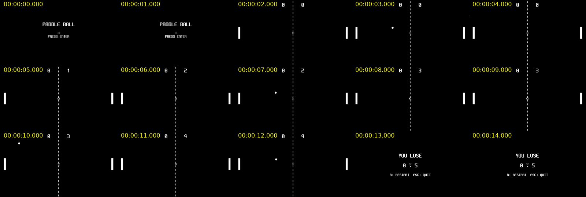
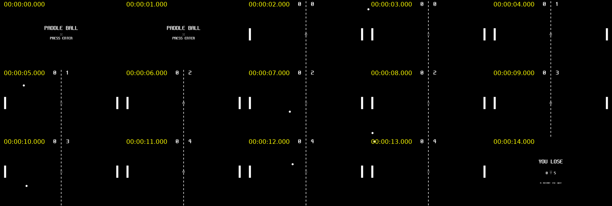

# 시범 실행 보고 (2026-11-14)

SeoulTech-Fiat-Lux/Meno#29의 하위 이슈 "하니스와 시범 실행"(#2)의 결과다. 하니스가 처음부터 끝까지 도는지,
본 실행 전에 무엇을 고쳐야 하는지 보려고 돌렸다. 퐁은 시범에만 쓰므로(PLAN 2절) 이 결과는 본 분석에 넣지 않는다.

## 요약

- **흐름이 끝까지 돈다.** 모델 호출 → 빌드(→ 실패 시 오류 피드백과 재시도) → 30초 무입력 실행·녹화 → 기록이 6회차 모두에서 멈춤 없이 돌았다.
- **6/6 회차가 1왕복에 빌드되고 30초를 버텼다.** 녹화로 본 무입력 기준도 두 조건 모두 충족했다.
- **문맥 토큰은 meno 47,675, SFML 79,747이다** (1.67배). 바이트로는 2.2배지만, 한국어인 meno 문서가 바이트당 토큰이 더 많다.
- **출력의 약 83%가 추론 토큰이다** (`effort = medium`). 코드는 5천 토큰 안팎이다.
- **시범에서 문제 5개를 찾아 고쳤다** (아래 "고친 문제"). 아직 확인할 것은 구독 한도다.

## 조건

| 항목 | 값 |
|---|---|
| 기록 | `runs/pilot-e1712ed0/` (입력 해시 `e1712ed00477`) |
| 모델 | `claude-haiku-5-5`, Claude Code 2.1.325 (Claude Max 구독), `effort = medium` |
| 출력 상한 | 64,000 토큰 (추론 포함) |
| 회차 | 퐁 × 조건 2 × 반복 3 = 6 |
| meno / SFML | `46f8934` (v0.2.0) / `8835b6b` (3.1.0) |
| 환경 | WSL2 Ubuntu 24.04.5, GCC 13.3.0, CMake 3.28.3, Mesa 25.2.8 (llvmpipe), Ryzen 7 9700X 16스레드 |
| 시각 | 2026-11-14 12:05–12:21 UTC (6회차 16분) |

## 결과

| 조건 | 회차 | 빌드 성공 | 1왕복 성공 | 입력 토큰 | 그중 캐시 읽기 | 출력 토큰 | 그중 추론 | 코드 줄 | LLM 시간 | 회차 시간 |
|---|---|---|---|---|---|---|---|---|---|---|
| meno | 3 | 3 | 3 | 53,413 | 53,040 | 30,421 | 25,367 | 248–284 | 126초 | 154초 |
| SFML | 3 | 3 | 3 | 85,340 | 84,966 | 34,892 | 28,796 | 367–377 | 144초 | 171초 |

값은 회차 평균(코드 줄은 범위)이다. 퐁 6회차뿐이라 조건 차이에 의미를 두지 않는다.

**회차별**

| 회차 | 코드 줄 | 출력 / 추론 토큰 | LLM 시간 | 무입력 종료 코드 | 프레임 p95 |
|---|---|---|---|---|---|
| meno r1 | 248 | 27,674 / 22,737 | 114.5초 | 124 (30초 생존) | 17.84ms |
| meno r2 | 284 | 32,884 / 27,780 | 137.1초 | 124 | 17.77ms |
| meno r3 | 269 | 30,705 / 25,583 | 127.2초 | 124 | 17.97ms |
| SFML r1 | 367 | 37,992 / 31,827 | 155.7초 | 124 | 18.28ms |
| SFML r2 | 377 | 31,450 / 25,283 | 131.2초 | 124 | 17.91ms |
| SFML r3 | 367 | 35,234 / 29,278 | 145.8초 | 124 | **20.91ms** |

**문맥 토큰** (`run.py --measure-context`, 문맥을 넣은 호출과 뺀 호출의 입력 토큰 차이)

| 조건 | 문맥 바이트 | 문맥 토큰 | 바이트당 토큰 |
|---|---|---|---|
| meno (한국어) | 104,079 | 47,675 | 0.46 |
| SFML (영어) | 215,126 | 79,747 | 0.37 |

## 체크리스트 (이슈 #2)

| 항목 | 결과 |
|---|---|
| 모델 호출과 토큰 집계 | 확인. LiteLLM 대신 구독 CLI로 바꿨다. Claude의 `prompt_tokens`는 캐시 읽기·쓰기를 더한 원래 입력 토큰이다(입력 85,340 = 캐시 밖 2 + 캐시 쓰기 372 + 캐시 읽기 84,966) |
| 빌드와 재시도 루프 | 확인. 시범에서는 재시도가 일어나지 않아, mock(첫 답에 일부러 오류를 넣음)으로 따로 돌렸다: 두 조건 모두 왕복 1 실패 → 컴파일 오류 피드백 → 왕복 2 성공 → 무입력 실행 |
| Xvfb 실행, 녹화, 무입력 기준 | 확인. 6/6 종료 코드 124(30초 생존). 무입력 기준은 아래 "녹화 판정" |
| 회차별 JSONL 기록 | 확인 (`runs-light.jsonl`, 형식은 `harness/records.py`) |
| 시범 실행과 문제점 정리 | 이 문서 |

## 녹화 판정

명세 기준: 약 4.5초에 CPU 첫 득점, 10초 안에 CPU 2점 이상. 1초 간격 장면 모음(`analysis/contact_sheet.sh`)으로 판정했다.

| 시각 | meno r1 | SFML r1 |
|---|---|---|
| 0–1초 | 타이틀 "PADDLE BALL", "PRESS ENTER" | 같음 |
| 2초 | 플레이 시작 | 같음 |
| CPU 1점 | 5초 장면 | 4초 장면 |
| CPU 2점 | 6초 장면 | 6초 장면 |
| 결과 화면 | 13초 "YOU LOSE 0 : 5" | 14초 "YOU LOSE 0 : 5" |

두 조건 모두 기준을 충족한다. 장면 모음을 쓰면 영상을 돌려 보지 않고도 판정할 수 있다.

## 고친 문제 (시범 중 발견)

| 문제 | 영향 | 고침 |
|---|---|---|
| 명세의 에셋 경로가 `fonts/game.ttf`(본문)와 `assets/…`(실행 환경)로 섞임 | 생성 코드가 `assets/` 없이 열어 시작 직후 종료(종료 코드 1) | 명세 11종의 169곳을 `assets/…` 전체 경로로 바꾸고 채점표를 다시 생성 |
| 1초 미만 종료에서 `bc`가 `.31`을 써서 result.json이 깨짐 | 하니스 전체가 멈춤 | `printf`로 `0.310` 꼴로 쓰고, 결과 파일이 깨져도 기록하고 계속 |
| Claude Code가 출력 상한을 넘으면 답 대신 오류를 냄 | 일시 오류로 보고 같은 요청을 다시 보내 한도 낭비 | 잘린 왕복으로 세고, 답하지 못한 요청을 잘림 안내와 함께 다시 보냄 |
| Claude Code 2.1.3xx는 상한에서 끊은 뒤 이어 쓰고 마지막 조각만 돌려줌 (`num_turns > 1`) | 잘린 코드를 정상 답으로 볼 수 있음 | 도구를 껐으므로 2턴 이상이면 잘린 답으로 처리 |
| 출력 상한 32,000에 추론 토큰이 포함됨 | `effort = high`의 Haiku가 퐁에서 상한을 넘김 | `effort = medium`, 상한 64,000 |

## 새로 알게 된 것

- **프레임 시간 p95가 흔들린다.** 6회 중 1회(SFML r3)가 20.91ms로 기준 20ms를 넘었다. 나머지는 17.77–18.28ms다. 60 FPS 제한에서 여유가 약 3ms뿐이라 PC 부하(녹화 인코딩 등)에 따라 달라진다. 이 항목은 탐색 지표로만 쓴다(PLAN 3절 "탐색"). 본 실행 중에는 같은 PC에서 다른 무거운 일을 돌리지 않는다.
- **추론 토큰이 출력의 대부분이다.** 출력 상한 64,000은 퐁에서 여유가 있지만(최대 37,992), 큰 게임(서바이버류 등)에서는 다시 확인해야 한다. 본 실행 첫 회차들의 `truncated_rounds`를 확인한다.
- **캐시가 첫 왕복부터 걸린다.** 연달아 돈 회차는 같은 문맥을 캐시에서 읽었다(입력의 99%). 비교 지표는 캐시와 무관한 원래 토큰이라 영향을 받지 않지만, LLM 시간에는 캐시 효과가 섞인다(PLAN 3절 "한계"에 적은 대로).
- **퐁은 천장 효과가 있다.** 모든 회차가 1왕복에 성공해 조건 차이가 드러나지 않는다. 퐁을 시범에만 쓰기로 한 판단(PLAN 2절)이 맞았다.

## 남은 확인 (본 실행 전)

- **구독 한도:** 6회차로는 한도에 걸리지 않았다. Claude Max 1인의 72회차는 퐁 기준으로 쉬지 않고 약 3.3시간이지만, Opus와 큰 게임은 더 걸린다. 본 실행 첫날의 `cli_retries`로 5시간 한도 안에 몇 회차를 돌릴 수 있는지 본다.
- **Codex:** 확인. ChatGPT 구독자인 팀원이 2026-11-15 03:25–03:29 UTC에 동결 입력(`142e921e`, `freeze-1`)으로 퐁을 조건마다 1회씩 실제로 돌렸다 (`gpt-6.1-sol`, codex-cli 0.169.0, i5-13400F WSL2). 두 회차 모두 1왕복에 빌드되고 30초를 버텼다(종료 코드 124, 프레임 p95 SFML 17.46ms, meno 17.79ms). 기록은 `runs/pilot-142e921e/`(git 밖)에 있다.
- **퐁 채점표 시험 채점:** 끝. 한 회차에 항목당 약 14초가 걸려 PLAN 2절의 채점 시간 추정을 고쳤다.
- **동결 전제:** `specs/sim/` 스크립트(D7), 채점표 항목 확정, 1차 지표 확정.
