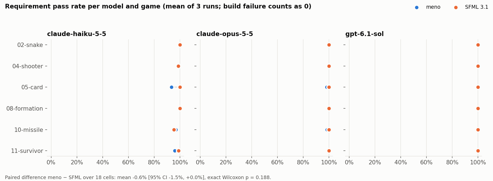
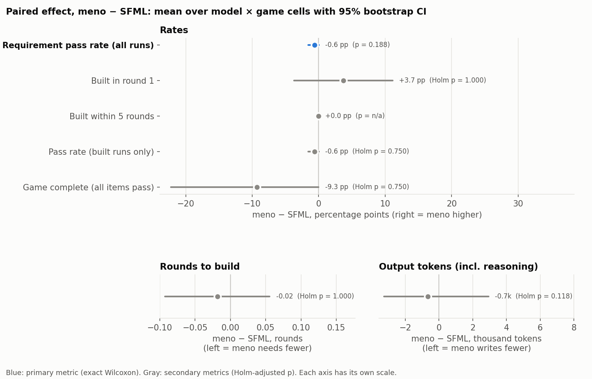
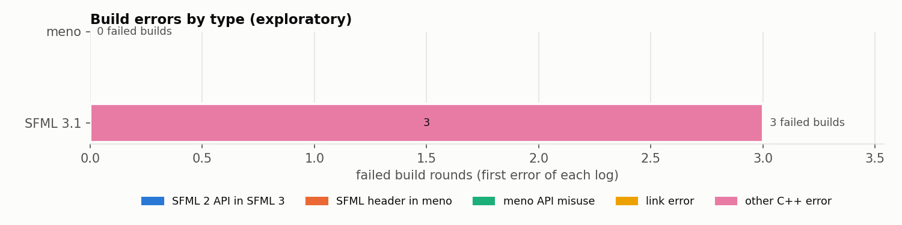

# 분석 결과

회차 폴더 `runs/main`: 회차 108개, 채점된 회차 108개.
차이 = meno − SFML (셀 = 모델 × 게임, 셀 안 반복 평균). 비율의 차이는 %p(퍼센트포인트)다.
검정: 양측 정확 Wilcoxon 부호순위(0인 차이 제외). 신뢰구간: 셀 부트스트랩 10,000회 95%.

## 요약

- **1차 지표(요구사항 통과율, 전체 회차):** meno − SFML = **-0.6%p** [-1.5%p, +0.0%p], 정확 Wilcoxon p = 0.188 (18쌍). α = 0.05에서 유의하지 않다.
- **민감도 판정:** **강건하지 않음.** 어떤 모델 또는 모델 하나를 뺀 경우에서 차이의 방향이 전체와 다르거나 0이다. 1차 결론을 특정 모델의 결과로 한정해 보고한다.

## 1차 지표

| 지표 | 짝 | meno | SFML | 평균 차이 [95% CI] | 중앙값 차이 [95% CI] | p | 
|---|---|---|---|---|---|---|
| 요구사항 통과율 (전체 회차, 빌드 실패 = 0) | 18 | 99.0% | 99.6% | -0.6%p [-1.5%p, +0.0%p] | +0.0%p [+0.0%p, +0.0%p] | 0.188 |

## 2차 지표 (Holm 보정)

| 지표 | 짝 | meno | SFML | 평균 차이 [95% CI] | 중앙값 차이 [95% CI] | p | Holm p |
|---|---|---|---|---|---|---|---|
| 1왕복 빌드 성공률 | 18 | 92.6% | 88.9% | +3.7%p [-3.7%p, +11.1%p] | +0.0%p [+0.0%p, +0.0%p] | 0.625 | 1.000 |
| 최종 빌드 성공률 | 18 | 100.0% | 100.0% | +0.0%p [+0.0%p, +0.0%p] | +0.0%p [+0.0%p, +0.0%p] | - | - |
| 빌드 성공까지의 왕복 수 | 18 | 1.09 | 1.11 | -0.02 [-0.09, +0.06] | +0.00 [+0.00, +0.00] | 1.000 | 1.000 |
| 출력 토큰 | 18 | 25,902 | 26,569 | -666 [-3,263, +2,938] | -757 [-3,381, -92] | 0.024 | 0.118 |
| 요구사항 통과율 (빌드한 회차만) | 18 | 99.0% | 99.6% | -0.6%p [-1.5%p, +0.0%p] | +0.0%p [+0.0%p, +0.0%p] | 0.188 | 0.750 |
| 게임 완성률 (모든 플레이 항목 통과) | 18 | 83.3% | 92.6% | -9.3%p [-22.2%p, +0.0%p] | +0.0%p [+0.0%p, +0.0%p] | 0.250 | 0.750 |

## 탐색적 지표 (보정 없음)

| 지표 | 짝 | meno | SFML | 평균 차이 [95% CI] | 중앙값 차이 [95% CI] | p | 
|---|---|---|---|---|---|---|
| 코드 줄 수 (빈 줄 제외) | 18 | 437 | 558 | -121 [-154, -87] | -121 [-166, -67] | <0.001 |
| 추론 토큰 | 18 | 18,802 | 18,456 | +346 [-1,679, +3,170] | -109 [-416, +145] | 0.442 |
| 답변 토큰 (출력 − 추론) | 18 | 7,100 | 8,113 | -1,013 [-1,995, +40] | -960 [-1,683, -428] | 0.016 |
| LLM 시간(초) | 18 | 142.3 | 154.7 | -12.4 [-26.4, +3.8] | -10.2 [-23.1, -0.6] | 0.024 |
| 무입력 10초 안 종료 | 18 | 0.0% | 0.0% | +0.0%p [+0.0%p, +0.0%p] | +0.0%p [+0.0%p, +0.0%p] | - |
| 프레임 시간 p95 ≤ 20ms | 18 | 100.0% | 100.0% | +0.0%p [+0.0%p, +0.0%p] | +0.0%p [+0.0%p, +0.0%p] | - |

## 참고

## 1차 지표 민감도 분석 (사전 등록)

모델 층화 부트스트랩 평균 차이 95% CI: [-1.4%p, +0.0%p]

| 모델 | 짝 | 평균 차이 | meno 우세 / SFML 우세 / 같음 | p (참고) | 이 모델을 뺀 평균 차이 | 뺀 뒤 p |
|---|---|---|---|---|---|---|
| claude-cli/claude-haiku-5-5 | 6 | -1.4%p | 1 / 2 / 3 | 0.500 | -0.3%p | 0.500 |
| claude-cli/claude-opus-5-5 | 6 | -0.5%p | 0 / 2 / 4 | 0.500 | -0.7%p | 0.500 |
| codex-cli/gpt-6.1-sol | 6 | +0.0%p | 0 / 0 / 6 | - | -0.9%p | 0.188 |

판정: **강건하지 않음.** 어떤 모델 또는 모델 하나를 뺀 경우에서 차이의 방향이 전체와 다르거나 0이다. 1차 결론을 특정 모델의 결과로 한정해 보고한다.

## 탐색: 1차 지표의 게임별 평균 차이

| 게임 | 짝 | 평균 차이 |
|---|---|---|
| 02-snake | 3 | +0.0%p |
| 04-shooter | 3 | +0.0%p |
| 05-card | 3 | -2.8%p |
| 08-formation | 3 | +0.0%p |
| 10-missile | 3 | +0.0%p |
| 11-survivor | 3 | -1.0%p |

## 탐색: 실패한 빌드의 첫 오류 유형 (왕복 단위)

| 조건 | 그 밖의 C++ 오류 (`cpp`) |
|---|---|
| sfml | 3 |

